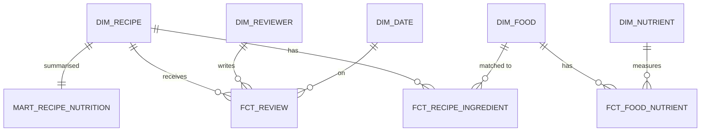

# Fuel Smart — archived portfolio project brief

This project was replaced by [Flight Reliability](flights-project-brief.md) on October 14, 2026. Retained as a reference for standalone recipe exercises.

**One data space: food and nutrition.** Fuel Smart helps you eat well for training without counting calories. It turns public recipe, ingredient and packaged-food data into trusted nutrition metrics, a dashboard and, later, an evaluated "what should I cook?" agent.

It replaces the earlier GitHub-activity project in the tracker's portfolio stages. The learning roadmap and stage order are unchanged; only the data and the question are new.

## Why this project

| It shows | How |
|---|---|
| A clear purpose | A question people care about: which simple recipes give the most protein and fibre per calorie, and do people still enjoy them? |
| Real data-engineering difficulty | Ingredient lines such as `2 cups chopped onion` must be parsed, converted to grams and matched to a nutrient reference. |
| Analytics engineering | Precise metric definitions, grain, tests, contracts and a semantic layer over certified nutrition metrics. |
| Scale when you need it | Open Food Facts has 3.7M+ messy products and daily change files for the lakehouse, orchestration and quality releases. |
| AI with evaluation | LLM ingredient parsing and an agent, both measured against a hand-labelled answer set. |
| Your interests | Cooking, intuitive healthy eating and gym fuelling (protein targets on training days). |

## Datasets

| Dataset | What it gives | Access | Licence |
|---|---|---|---|
| [Food.com recipes and reviews](https://www.kaggle.com/datasets/irkaal/foodcom-recipes-and-reviews) | About 500k recipes (ingredient quantities and names, steps, times, servings, listed nutrition) and 1.4M dated reviews with ratings | Kaggle download (free account) | CC0 |
| [USDA FoodData Central](https://fdc.nal.usda.gov/download-datasets/) | Trusted nutrients per food. Foundation Foods and SR Legacy (final, never updated) include household portions in grams, such as 1 cup chopped. Branded Foods is updated monthly. | CSV/JSON downloads; [REST API](https://fdc.nal.usda.gov/api-guide) with a free data.gov key | CC0 |
| [Open Food Facts](https://world.openfoodfacts.org/data) | 3.7M+ packaged products: nutriments, ingredients, Nutri-Score, NOVA processing group | Nightly JSONL/CSV/MongoDB exports, [Parquet on Hugging Face](https://huggingface.co/datasets/openfoodfacts/product-database), daily delta files for the last 14 days | ODbL (attribution, share-alike) |
| Your training log (optional) | Training days, used to set protein targets | Hevy/Strong CSV export | Yours; keep it out of the public repository |

Licensing: credit Open Food Facts and share any published derived product table under ODbL. USDA and Food.com data need no permission; attribution is still good practice.

## First release (v1)

**Question:** Which simple recipes (10 ingredients or fewer, ready in 45 minutes or less) give the most protein and fibre per 100 kcal and contain the most vegetables, and do reviewers rate them as highly as other recipes?

**Dataset contract (`dataset.yml`):**

- A fixed sample of **5,000 Food.com recipes**, chosen deterministically (for example, the lowest hash of the recipe ID), plus all of their reviews.
- **USDA Foundation Foods and SR Legacy**, pinned to named release dates.
- Record the source file versions, the sampling rule, retained counts and anything you dropped.
- Commit a small offline fixture (about 50 recipes) so anyone can rebuild the project without downloads.

**Three metrics** (grain: one recipe serving):

| Metric | Definition to make precise |
|---|---|
| Protein density | Grams of protein per 100 kcal for each serving. Kcal comes from matched ingredients. Exclude a recipe when less than 80% of its ingredient weight is matched, and say so. |
| Fibre density | Grams of fibre per 100 kcal, with the same matching rule. |
| Vegetable & legume share | Share of matched ingredient weight that comes from USDA vegetable and legume food groups. This is the "intuitive plate" signal and needs no calorie counting. |

Ratings use the existing review scores. Compare groups only when each has enough reviews, and report the count.

**Hard parts to plan for:**

1. **Parse ingredient data.** Quantities and ingredient names are stored as separate text lists (`RecipeIngredientQuantities`, `RecipeIngredientParts`). Pair them carefully, normalise fractions (`1 1/2`, `½`, `2-3`) and handle missing units.
2. **Convert to grams** using USDA food portions, for example "1 cup, chopped = 160 g" or "1 medium". Ingredients with no usable portion data are unmatched, not guessed.
3. **Match foods** to USDA records with a match-confidence score. Hand-label 200 ingredient lines as an answer set and report precision and coverage.
4. **Reconcile.** Food.com also lists its own nutrition for each recipe (protein, fibre, calories and more). Work out whether those values are per serving or per recipe, then compare them with your computed values and explain the gaps.
5. **Check calories.** Protein × 4 + carbohydrate × 4 + fat × 9 should be close to the stated kcal. Flag foods and products where it isn't.

**Model sketch:**



- `fct_recipe_ingredient`: one row per recipe ingredient line, with parsed quantity, unit, grams, matched food and match confidence.
- `fct_review`: one row per review, with reviewer, recipe, date and rating.
- `mart_recipe_nutrition`: one row per recipe serving, with the three metrics and the matching coverage.

**Out of scope for v1:** Open Food Facts, orchestration, Spark, AI, personal data. Each comes in a later release.

## Releases

| Release | What you add | Data |
|---|---|---|
| v1: First release | The question, a bounded ingester, ingredient matching, a model, tested dbt marts and a dashboard on DuckDB | Food.com sample and USDA |
| Lakehouse | Full Food.com and the Open Food Facts Parquet file as local bronze and silver Delta tables, de-duplicated by barcode, with a quarantine table | Open Food Facts, about 4 GB Parquet |
| Orchestration | Airflow loads the daily Open Food Facts delta files and the monthly USDA Branded Foods releases; backfills and recovery | Delta files, USDA releases |
| Quality & observability | The calorie check, unit and outlier checks, freshness SLA, reconciliation and an incident postmortem | All |
| Performance & cost | Benchmarks of ingredient matching and product scans. Reach larger volumes with the uncompressed JSONL export and a labelled synthetic scale factor. | All |
| Semantic layer | 8–12 certified nutrition metrics feeding the dashboard | Marts |
| AI agent + evaluation | A "what should I cook?" agent over the semantic layer, plus LLM ingredient extraction with cost per 1,000 rows, both evaluated | Marts and the answer set |
| Portability | Terraform, least-privilege access and the gold layer on Snowflake | Marts |
| Architecture docs and story | Decision records, the architecture document and a three-minute demo | — |
| Optional personal layer | Training days from your Hevy/Strong export set daily protein targets; kept private | Your data |

## Suggested repository layout

```text
fuel-smart/
  dataset.yml          # sample rule, source versions, limits
  ingest/              # Python CLI: download, sample, USDA API client, fixture
  parse/               # ingredient parsing, unit conversion, matching + answer set
  models/              # dbt: staging, intermediate, marts, semantic
  tests/               # pytest + dbt unit tests
  docs/                # question, metric spec, model, decisions
  dashboard/
```

## Risks and mitigations

| Risk | Mitigation |
|---|---|
| Ingredient matching never feels "done" | Fix the answer set early, report coverage honestly, and exclude recipes below the coverage threshold. |
| Results look like nutrition advice | State that metrics describe recipe data, not personal health guidance. |
| Open Food Facts licence obligations | Attribute it, and publish derived product tables under ODbL or not at all. |
| Scope creep across releases | Ship v1 first. Each release adds exactly one capability. |
