# Dashboard storytelling: chart choice, decluttering and headline-first dashboards

*Companion to `dashboard-storytelling.html`: same lessons, same numbering, same code, outputs and charts. Hints and solutions are in Appendices A and B.*

**Tested with:** CPython 3.12.10 on Windows 11 (64-bit), matplotlib 3.11.2 (Agg backend, PNG output), NumPy 2.5.3, DuckDB 1.5.6 (Python package, only to read the CSV fixtures) and pytest 9.1.1. Every Python block and command with an output was executed while this document was built, and every chart image in `images/` was drawn by the code shown next to it. The data is synthetic and deterministic (`make_data.py`, lesson 3). **Power BI is the familiar baseline but was not executed:** lesson 13 maps each idea to its Power BI feature, and the DAX and theme snippets there are labelled “not executed — requires Power BI Desktop”.

**Gap deck:** it teaches only what earlier decks leave out. *Diagnosing metric changes: trees, mix shift, and the weekly business review* already builds a headline-first WBR table and a five-line write-up (its lab steps 4–5); *Metric design: define the number before writing SQL* already defines the metrics. This deck adds the visual layer: chart choice, decluttering, headline-first dashboards, honest and accessible charts, a critique checklist and a redesign. New terms are defined on first use and collected in the glossary. Most lessons end with an **On the job** note.

**Interview focus:** the interview questions and exercises are based on common data-visualisation and dashboard interview patterns (research done in October 2026: “which chart and why”, “critique this dashboard”, misleading charts, two scales, accessibility for PL-300, “stakeholders say it is too complex”). All questions are original and use the Leafy data or the Fuel Smart portfolio.

**Additions beyond the original brief** are marked *(added)*: an automated chart linter (`dashlint.py`) that turns the checkable half of the critique checklist into tests; a data-driven headline function so the title can never disagree with the numbers; incomplete (partial) periods as a misleading-chart pattern; WCAG contrast maths, the grayscale test and alt text within Power BI’s 250-character limit; a matplotlib → Power BI mapping, including a dynamic DAX headline (shown, not executed); a weekly critique routine with public practice sources.

## Contents

1. [Dashboard storytelling](#slide-1)
   - [Why this matters · Why this matters on the job](#why-1)
   - [Why this matters · When to reach for it, and when not to](#why-2)
2. [Set up, versions, and what was tested](#slide-2)
3. [The running example: Leafy’s weekly dashboard extract](#slide-3)
4. [Start from the message, then choose the chart](#slide-4)
5. [Comparison and ranking: sorted bars beat pies](#slide-5)
6. [Trend: lines for change over time](#slide-6)
7. [Composition, distribution and relationship](#slide-7)
8. [Declutter: remove everything that does not carry data](#slide-8)
9. [Headline titles: say the finding, computed from the data](#slide-9)
10. [Colour and numbers with purpose](#slide-10)
11. [Headline-first dashboards: the inverted pyramid](#slide-11)
12. [KPI cards and when a table wins](#slide-12)
13. [The same ideas in Power BI](#slide-13)
14. [Misleading charts: honest numbers, false stories](#slide-14)
15. [Accessibility: contrast, colour and alt text](#slide-15)
16. [The critique checklist, and a weekly habit](#slide-16)
17. [Lab: critique and redesign Leafy’s weekly dashboard](#slide-17)
18. [Lab step 1: critique with the checklist](#slide-18)
19. [Lab step 2: the headline and the wireframe](#slide-19)
20. [Lab step 3: build the page and run the checks](#slide-20)
21. [In your portfolio: redesign the Fuel Smart page once](#slide-21)
22. [Bug clinic: believable chart and dashboard bugs](#slide-22)
23. [Interview questions and model answers](#slide-23)
24. [Exercises 1–4 · choose, predict, declutter, headline](#slide-24)
25. [Exercises 5–7 · honesty and accessibility](#slide-25)
26. [Exercises 8–10 · critique, design, take-home](#slide-26)
27. [Cheat sheet](#slide-27)
28. [Glossary](#slide-28)
29. [Recap and practice plan](#slide-29)
30. [References and how this deck was tested](#slide-30)
31. [Appendix A · Hints](#appendix-a)
32. [Appendix B · Solutions](#appendix-b)

---

<a id="slide-1"></a>
## 1. Dashboard storytelling

**

*Diagnosing metric changes* gave you the weekly business review (WBR) table and the five-line write-up. This deck adds the visual layer around them: choose the chart from the message, declutter it, put the finding in the title, lay out a page that reads top-left first, keep it honest and accessible, and critique any dashboard with one checklist. Every chart is drawn twice, before and after, from the same Leafy data.

- **Part A, choose:** message first; comparison, trend, composition, distribution and relationship charts.
- **Part B, declutter:** remove the noise, headline titles, colour and numbers with purpose.
- **Part C, headline-first pages:** the inverted-pyramid layout, KPI cards, and the same ideas in Power BI.
- **Part D, honest and accessible:** misleading charts, contrast and alt text, the critique checklist.
- **Practice:** the lab (critique and redesign Leafy's weekly dashboard, then your Fuel Smart page), a bug clinic, interview questions with model answers, and 10 exercises.

Every chart image was drawn by the code next to it while the deck was built. Power BI is mapped, not executed.

**Additions beyond the brief** (marked *added*): an automated chart linter (`dashlint.py`) that turns the checkable half of the critique checklist into tests; a data-driven headline function so the title can never disagree with the numbers; incomplete (partial) periods as a misleading-chart pattern; WCAG contrast maths, the grayscale test and alt text within Power BI’s 250-character limit; a matplotlib → Power BI mapping, including a dynamic DAX headline (shown, not executed); a weekly critique routine with public practice sources.

---

<a id="why-1"></a>
## Why this matters · Why this matters on the job

*Why this matters · the need behind the topic*

A correct number on a confusing page is a wasted number. Leaders look at a dashboard for a few seconds before a meeting; if the page does not say what changed, why, and what to do, the decision is made on gut feel or on the wrong tile. Analytics engineers own the models and metrics behind those pages and are more and more often asked to build or review the pages too. This deck teaches the visual layer: **choose the chart from the message, remove what carries no data, lead with the headline, and keep every chart honest and readable by everyone**. It ends with a critique checklist you can partly automate.

#### Where you will use it

- The weekly business review page that leadership opens every Monday.
- A Power BI report you publish on top of your certified semantic model.
- The chart in an incident write-up or a pull request that proves a fix worked.
- The five-minute presentation at the end of a take-home assignment.
- Your portfolio dashboard: the first thing a hiring manager looks at.

#### What goes wrong without it

- The real problem (one platform, one release) hides in tile five of six.
- A partial week looks like a collapse and starts a fire drill.
- A truncated axis turns a 1.5 % gap into a crisis.
- Red/green status tiles are unreadable for about 1 in 12 men.
- Nobody opens the dashboard after the launch week.

#### Who expects you to know it

- Analytics engineers and BI developers: build and review the pages on top of their models.
- Data analysts: present findings every week.
- Data engineers: chart pipeline health, costs and incidents.
- Interviewers: “which chart and why” and “critique this dashboard” appear in most analytics loops; the PL-300 exam tests visual choice and accessibility.

> **On the job:** Your new manager forwards a six-tile Power BI page with the note: “Leadership says this tells them nothing. Can you fix it before Monday?” A strong answer is a 20-minute critique against a checklist, a headline computed from the model, a four-tier layout, and a page that passes automated checks for honesty and contrast before anyone sees it.

> **The main idea:** the page is part of the data product: choose, declutter and headline it as carefully as you model the numbers under it.

*Read more:* [Power BI: tips for designing a great dashboard](https://learn.microsoft.com/en-us/power-bi/create-reports/service-dashboards-design-tips), [Financial Times: Visual Vocabulary](https://github.com/Financial-Times/chart-doctor/tree/main/visual-vocabulary), [Exam PL-300 study guide](https://learn.microsoft.com/en-us/credentials/certifications/resources/study-guides/pl-300).

---

<a id="why-2"></a>
## Why this matters · When to reach for it, and when not to

*Why this matters · choosing the right tool*

| Situation | Reach for | Why |
|---|---|---|
| One finding must reach busy readers (WBR, incident, executive update) | Headline title + KPI cards + one proving chart (lessons 9, 11–12) | The sentence is read first; the chart only has to prove it. |
| Comparing categories or ranking them | Sorted bars with direct labels (lesson 5) | Position and length are read most accurately. |
| Change over time | Line chart of complete periods (lesson 6) | Lines show direction and shape; partial periods lie. |
| Spread, waiting times, tails | Histogram or strip plot (lesson 7) | An average hides who waits a week. |
| Readers need exact values for many measures | A formatted table (the WBR table in *Diagnosing metric changes*) | Looking up values beats spotting patterns here; do not force a chart. |
| Open-ended exploration by analysts | Not a polished dashboard | Exploration needs many quick charts; polish only what others will reuse. |

#### How interviews test it

- “Which chart would you use to show X, and why not a pie?” (message first, encoding accuracy).
- “Here is a dashboard. What would you change?” (a structured walk: purpose, headline, honesty, chart fit, clutter, colour, accessibility, layout).
- “How can a chart mislead?” (truncated and dual axes, partial periods, cherry-picked windows).
- “How do you show two measures with different scales?” and “How do you make a report accessible?” (PL-300).

#### Where it sits in your learning path

- Builds on *Metric design: define the number before writing SQL* (what each number means) and *Diagnosing metric changes: trees, mix shift, and the weekly business review* (the WBR table and the five-line write-up, which this deck does not repeat).
- Next: put certified metrics in a semantic layer so the dashboard and its headline read the same definition.

> **The main idea:** reach for a headline-first page whenever someone must act on the numbers; keep exploration quick and unpolished.

---

<a id="slide-2"></a>
## 2. Set up, versions, and what was tested

*Start here · one small lab folder, files instead of windows*

| Item | Detail |
|---|---|
| Tested with | **CPython 3.12.10** on Windows 11, **matplotlib 3.11.2** (NumPy 2.5.3), **DuckDB 1.5.6** (Python package, only to read the CSV files) and **pytest 9.1.1**. |
| What ships with the deck | `images/`: every before/after chart in this deck. `dashboard-storytelling-lab/`: the data generator and CSV fixtures, `chartkit.py` (the helpers built lesson by lesson), the “before” dashboard, `dashlint.py` (automated checks), the critique checklist, a model redesign and tests. |
| What was executed | Every Python block and command with an output, in a fresh copy of the lab folder. Each PNG was written by the block that shows `saved images/…`. |
| What was not executed | **Power BI.** It is the tool you will most likely use at work, so lesson 13 maps every idea to its Power BI feature; its DAX and theme snippets are labelled “not executed — requires Power BI Desktop”. |
| Minimum versions | Python 3.10 or newer; matplotlib 3.7 or newer (`subplot_mosaic` with `height_ratios`, bar containers that know their orientation); DuckDB 1.1 or newer. |

#### Create the environment

```text
# Windows PowerShell, from the folder that holds this deck
cd dashboard-storytelling-lab
python -m venv .venv
.venv\Scripts\Activate.ps1          # macOS/Linux: source .venv/bin/activate
python -m pip install -r requirements.txt
```

#### Check it

```python
import sys, matplotlib, duckdb
print("Python", sys.version.split()[0], "· matplotlib", matplotlib.__version__,
      "· DuckDB", duckdb.__version__)
print("backend:", matplotlib.get_backend())
```

Output:

```text
Python 3.12.10 · matplotlib 3.11.2 · DuckDB 1.5.6
backend: Agg
```

**Agg** is matplotlib’s non-interactive **backend** (the part that turns a figure into pixels): it draws straight into PNG files, needs no screen, and gives the same pixels on a laptop and a build server. Every block in this deck starts from the first part of `chartkit.py`, shown below. **rcParams** are matplotlib’s global defaults; `STYLE` switches off the noise once (lesson 8 explains each line), and the palette has only two kinds of colour: grays for context and one accent for the point (lesson 10 explains why).

```python
import matplotlib
matplotlib.use("Agg")                      # draw into files: no window, same pixels everywhere
import matplotlib.pyplot as plt
import duckdb
from pathlib import Path

INK, MUTED, GRAY, LIGHT = "#1f2a24", "#56605a", "#8b948f", "#e3e7e4"
ACCENT = "#c2410c"                          # the one colour that means "look here"

STYLE = {                                   # the quiet defaults every "after" chart starts from
    "figure.dpi": 100, "savefig.dpi": 100, "font.size": 10,
    "axes.spines.top": False, "axes.spines.right": False, "axes.edgecolor": GRAY,
    "axes.titlelocation": "left", "axes.titlesize": 12, "axes.titleweight": "bold",
    "axes.titlecolor": INK, "axes.labelcolor": MUTED, "axes.grid": False,
    "xtick.color": MUTED, "ytick.color": MUTED, "legend.frameon": False, "text.color": INK,
}


def use_style():
    plt.rcParams.update(STYLE)


def q(sql):
    """Run DuckDB SQL (it can read CSV files directly) and return a list of tuples."""
    return duckdb.sql(sql).fetchall()


def save(fig, path, dpi=None):
    """Save a PNG without machine-specific metadata, close the figure, report the file."""
    path = Path(path)
    path.parent.mkdir(parents=True, exist_ok=True)
    fig.savefig(path, dpi=dpi, bbox_inches="tight", metadata={"Software": None},
                pil_kwargs={"optimize": True})
    plt.close(fig)
    print("saved", path.as_posix())
```

> **On the job:** Headless rendering is how charts reach people without a BI tool: a nightly job that emails a PNG digest, a chart attached to a pull request or an incident ticket, a notebook in CI. Coming from C#: `rcParams` is like a shared theme resource dictionary in WPF; set it once instead of styling every control.

> **The main idea:** one folder, a dozen small helpers, real PNGs. The ideas are tool-independent; matplotlib just makes every step visible and testable.

*Read more:* [Matplotlib: backends (Agg)](https://matplotlib.org/stable/users/explain/figure/backends.html), [Matplotlib: rcParams and style sheets](https://matplotlib.org/stable/users/explain/customizing.html), [Matplotlib: savefig](https://matplotlib.org/stable/api/_as_gen/matplotlib.pyplot.savefig.html).

---

<a id="slide-3"></a>
## 3. The running example: Leafy’s weekly dashboard extract

*Start here · one extract, planted traps, two earlier decks*

Leafy is the series’ online plant shop. Its leadership team opens a weekly dashboard every Monday. `make_data.py` writes a small, deterministic extract: the same seed gives the same rows on every machine. The story is the one you diagnosed in *Diagnosing metric changes*: Android app 5.3 shipped on Monday 16 March and broke checkout. The numbers here are a separate synthetic extract built for charts, so they differ slightly from that deck.

Terminal:

```text
$ python make_data.py
weekly_platform.csv          36 rows
channel_orders.csv           14 rows
deliveries.csv              400 rows
campaigns.csv                20 rows
fuel_smart_recipes.csv       50 rows
```

```python
weeks = q("""
    SELECT week_start, MIN(days_in_data) AS days, SUM(sessions) AS sessions,
           SUM(orders) AS orders, ROUND(SUM(net_sales)) AS net_sales
    FROM 'data/weekly_platform.csv' GROUP BY week_start ORDER BY week_start""")
print("week_start  days sessions orders net_sales")
for w, days, s, o, ns in weeks[-4:]:
    print(w, f"{days:4} {s:8} {o:6} {ns:9,.0f}")
```

Output:

```text
week_start  days sessions orders net_sales
2026-03-02    7     2310    356    21,247
2026-03-09    7     2324    347    20,528
2026-03-16    7     2363    292    17,428
2026-03-23    2      671     82     4,950
```

| File (grain) | Used in | Trap planted on purpose |
|---|---|---|
| `weekly_platform.csv` (week × platform) | Trend, composition, KPI cards, the lab | The last week has only 2 of 7 days (`days_in_data`): plotted as a full week it looks like a collapse (lesson 14) |
| `channel_orders.csv` (week × channel) | Comparison and ranking | Two channels tie this week: sort order must be deterministic (lesson 5) |
| `deliveries.csv` (shipment) | Distribution | Both carriers average about 3 days; one makes 1 in 5 customers wait a week (lesson 7) |
| `campaigns.csv` (campaign) | Relationship | Conversion rises with discount up to 15 % and then stops (lesson 7) |
| `fuel_smart_recipes.csv` (recipe serving) | Your portfolio (lesson 21) | Recipes with 0–3 reviews: averages from tiny samples |

| Already taught (one-line recap) | Deck | This deck adds |
|---|---|---|
| A headline-first WBR table (fixed metric order, weekly sums, relative and absolute change) and a five-line write-up (what moved, why, evidence, impact, action) | *Diagnosing metric changes*, lab steps 4–5 (slides 12–13) | Charts and the page around them: which chart, how to declutter it, where it goes, and how to check it |
| What “net sales” and “session conversion” mean, and why ratios are computed from sums | *Metric design: define the number before writing SQL* | How to show those numbers so they cannot be misread |

> **On the job:** In the complete weeks, net sales moved from $20.5K to $17.4K (-15%), and Android conversion fell from 15% to 4%. Hold on to those numbers: every chart in this deck is judged by how fast a reader gets them, and by whether it could mislead someone about them.

> **The main idea:** one small extract with the traps real dashboards hit: partial periods, ties, averages that hide tails, and a story that should jump off the page.

*Read more:* [DuckDB Python API](https://duckdb.org/docs/stable/clients/python/overview).

---

<a id="slide-4"></a>
## 4. Start from the message, then choose the chart

*Part A · what should the reader take away?*

A **message** is the one sentence you want the reader to remember, written before you open a charting tool: “Organic search brings the most orders”, not “orders by channel”. A chart turns numbers into marks; the mapping from a number to a property of a mark (its position, length, angle, area or colour) is called a **visual encoding**. Decades of research on graphical perception rank how accurately people decode them: **position on a common scale** first, then length, then angle and slope, then area, then colour intensity. So the default answer is usually “put the number on a shared axis”.

| Message type | The reader asks | Default chart | Avoid |
|---|---|---|---|
| **Comparison / ranking** | Which is biggest? How do they rank? | Bars sorted by value (horizontal for long labels); a dot plot | Pies with many slices, unsorted bars, 3D |
| **Trend** (change over time) | Up, down, or unusual? | Line chart; columns for a handful of periods | Partial periods, uneven time steps, pies per month |
| **Composition** (part to whole) | What share is each part? Is the mix shifting? | One 100 % bar for a few parts; share-over-time lines | Pies with more than 3 parts, stacked areas with many layers |
| **Distribution** | How spread out? Who waits longest? | Histogram, strip plot, box plot | A single average bar |
| **Relationship** | Does X move with Y? | Scatter plot, outliers labelled | Two lines on twin axes |
| Deviation (added) | Above or below the target? | Bars diverging from the target or zero | Status shown by red/green alone |

The same numbers can carry different messages, and each message wants a different chart. Here are last week’s and this week’s orders per channel, drawn for two questions:

```python
rows = q("""
    SELECT channel,
           SUM(orders) FILTER (WHERE week_start = '2026-03-16') AS this_week,
           SUM(orders) FILTER (WHERE week_start = '2026-03-09') AS last_week
    FROM 'data/channel_orders.csv'
    GROUP BY channel ORDER BY this_week, channel DESC""")
names = [r[0] for r in rows]
now, before = [r[1] for r in rows], [r[2] for r in rows]

fig, (a, b) = plt.subplots(1, 2, figsize=(11, 3.4), sharey=True)
a.barh(names, now, color=GRAY, height=0.65)            # ranking: one sorted bar each
a.set_title("Which channel brings the most orders?")
b.hlines(names, now, before, color=LIGHT, lw=4)        # change: dot plot, last -> this week
b.plot(before, names, "o", color=GRAY, label="last week")
b.plot(now, names, "o", color=ACCENT, label="this week")
b.legend(loc="lower right")
b.set_title("Which channel lost the most?")
save(fig, "images/a4-same-data.png")
```

Output:

```text
saved images/a4-same-data.png
```

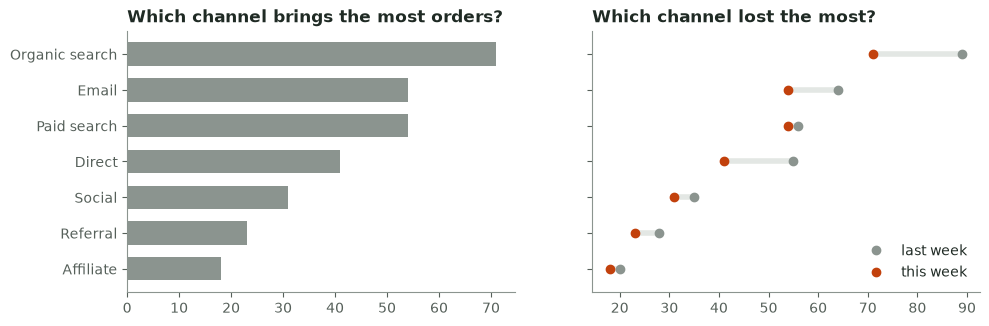

The left panel answers “who is biggest” at a glance; the right panel answers “who changed most” (Organic search and Direct lost the most). Neither chart answers both questions well, which is why the message comes first.

> **On the job:** When a stakeholder asks for “a chart of orders by channel”, reply with the question: “Do you want to see which channel is biggest, or which one changed?” That one question decides the chart and often reveals the decision behind the request (the intake routine is in *From vague ask to written spec*).

> **The main idea:** write the one-sentence message first; then choose the chart whose encoding (preferably position on a shared axis) makes that sentence obvious.

*Read more:* [Financial Times: Visual Vocabulary](https://github.com/Financial-Times/chart-doctor/tree/main/visual-vocabulary), [UK Analysis Function: data visualisation, charts](https://analysisfunction.civilservice.gov.uk/policy-store/data-visualisation-charts/), [Power BI: visualization types](https://learn.microsoft.com/en-us/power-bi/visuals/power-bi-visualization-types-for-reports-and-q-and-a).

---

<a id="slide-5"></a>
## 5. Comparison and ranking: sorted bars beat pies

*Part A · which category is biggest, and by how much?*

For a comparison the reader must judge sizes against each other. Bars put every value on the same baseline, so the eye compares lengths; a pie asks the eye to compare angles and areas, which it does badly, especially when slices are similar. Sort the bars by value so the ranking is free, use horizontal bars when labels are long, and write the values on the bars so the axis can go.

#### Before

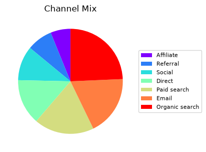

Seven similar slices and a legend: the reader looks back and forth between colours and names, and cannot tell that Email and Paid search tie.

#### After

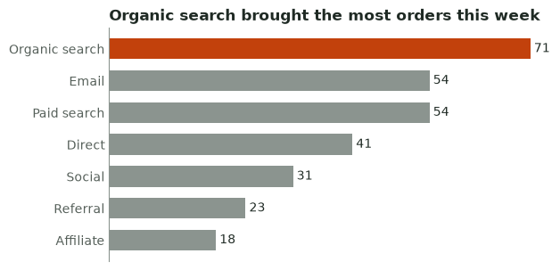

Sorted, labelled bars: the ranking, the tie and the gap to the leader are visible in one look.

```python
rows = q("""SELECT channel, orders FROM 'data/channel_orders.csv'
             WHERE week_start = '2026-03-16'
             ORDER BY orders, channel DESC""")     # barh draws bottom-up; ties broken by name
names, orders = [r[0] for r in rows], [r[1] for r in rows]

fig, ax = plt.subplots(figsize=(6.4, 3.4))
colors = [ACCENT if o == max(orders) else GRAY for o in orders]
bars = ax.barh(names, orders, color=colors, height=0.65)
ax.bar_label(bars, padding=3, color=INK)              # values on the bars...
ax.set_xticks([])                                      # ...so the value axis can go
ax.spines["bottom"].set_visible(False)
ax.tick_params(length=0)
ax.set_title("Organic search brought the most orders this week")
save(fig, "images/a5-after.png")

total = sum(orders)
print({n: f"{360 * o / total:.1f}°" for n, o in zip(names, orders) if o in (54, 41)})
```

Output:

```text
saved images/a5-after.png
{'Direct': '50.5°', 'Paid search': '66.6°', 'Email': '66.6°'}
```

The pie would draw Email and Paid search as two 66.6° slices pointing in different directions and Direct as a 50.5° slice: a 16° difference that readers routinely misjudge. The bars show the same facts as lengths on one baseline. Notice `ORDER BY orders, channel DESC`: with a tie, an order by value alone is not deterministic, so the two channels could swap places from one refresh to the next. Coming from C#: `OrderByDescending(c => c.Orders).ThenBy(c => c.Name)`.

<details><summary>How the “before” pie was drawn</summary>

```python
with plt.style.context("default"):                  # matplotlib's defaults, on purpose
    fig, ax = plt.subplots(figsize=(6.4, 3.4))
    ax.pie(orders, colors=plt.cm.rainbow([i / 6 for i in range(7)]), startangle=90)
    ax.legend(names, loc="center left", bbox_to_anchor=(1, 0.5), fontsize=8)
    ax.set_title("Channel Mix")
    save(fig, "images/a5-before.png")
```

Output:

```text
saved images/a5-before.png
```

</details>

> **On the job:** Pie charts are the most common thing reviewers ask you to change. Keep one only for two or three parts of a whole (“42 % of orders came from the app”). For everything else, a sorted bar chart is the safe default in Power BI, Tableau and matplotlib alike.

> **The main idea:** comparisons go on a shared baseline: sort the bars, break ties deterministically, label the values and drop the axis.

*Read more:* [Power BI: tips for designing a great dashboard](https://learn.microsoft.com/en-us/power-bi/create-reports/service-dashboards-design-tips), [Matplotlib: bar labels](https://matplotlib.org/stable/gallery/lines_bars_and_markers/bar_label_demo.html), [UK Analysis Function: data visualisation, charts](https://analysisfunction.civilservice.gov.uk/policy-store/data-visualisation-charts/).

---

<a id="slide-6"></a>
## 6. Trend: lines for change over time

*Part A · is it going up, down, or doing something unusual?*

Time runs left to right on the x-axis, in even steps. A line connects the periods, which tells the reader “this is one continuous quantity; look at its direction and shape”. Columns work for a handful of periods; with ten or more, a line is easier to read. Mark the event that explains a change with an **annotation**: a short label attached to a point. A line chart may start its y-axis above zero when the reader needs to see small changes; this one starts at zero because the drop is large enough to see without zooming.

#### Before

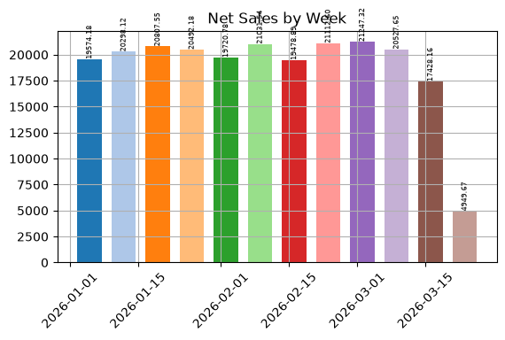

Rainbow columns, unreadable labels, and a last column that looks like a collapse: it holds only 2 of 7 days.

#### After

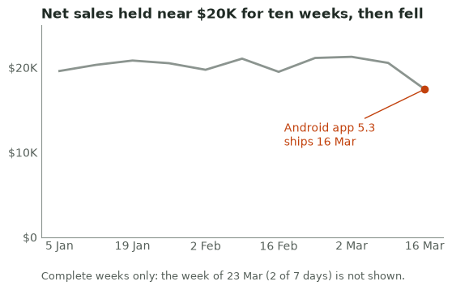

One line, the event annotated where it happened, complete weeks only, and the title states the finding.

```python
weeks = q("""SELECT week_start, MIN(days_in_data), SUM(net_sales)
              FROM 'data/weekly_platform.csv' GROUP BY 1 ORDER BY 1""")
done = [(w, s) for w, days, s in weeks if days == 7]       # complete weeks only (lesson 14)
xs, ys = [w for w, _ in done], [s for _, s in done]

fig, ax = plt.subplots(figsize=(6.4, 3.4))
ax.plot(xs, ys, color=GRAY, lw=2)
ax.plot(xs[-1], ys[-1], "o", color=ACCENT)
ax.annotate("Android app 5.3\nships 16 Mar", (xs[-1], ys[-1]), xytext=(-125, -50),
            textcoords="offset points", color=ACCENT,
            arrowprops=dict(arrowstyle="-", color=ACCENT))
ax.set_ylim(0, 25000)
ax.set_yticks([0, 10000, 20000], ["$0", "$10K", "$20K"])
ax.set_xticks(xs[::2], [f"{x.day} {x:%b}" for x in xs[::2]])
ax.tick_params(length=0)
ax.set_title("Net sales held near $20K for ten weeks, then fell")
ax.text(0, -0.2, "Complete weeks only: the week of 23 Mar (2 of 7 days) is not shown.",
        transform=ax.transAxes, fontsize=9, color=MUTED)
save(fig, "images/a6-after.png")
print(f"{len(xs)} complete weeks, last: {xs[-1]} {ys[-1]:,.2f}")
```

Output:

```text
saved images/a6-after.png
11 complete weeks, last: 2026-03-16 17,428.16
```

<details><summary>How the “before” columns were drawn</summary>

```python
with plt.style.context("default"):
    fig, ax = plt.subplots(figsize=(6.4, 3.4))
    bars = ax.bar([w for w, _, _ in weeks], [s for _, _, s in weeks], width=5,
                  color=plt.cm.tab20(range(len(weeks))))
    ax.bar_label(bars, fmt="%.2f", fontsize=6, rotation=90)
    ax.grid(True)
    ax.tick_params(axis="x", labelrotation=45)
    ax.set_title("Net Sales by Week")
    save(fig, "images/a6-before.png")
```

Output:

```text
saved images/a6-before.png
```

</details>

`f"{x.day} {x:%b}"` prints “9 Mar” on every operating system; the `%-d` shortcut for “no leading zero” works on Linux but not on Windows.

> **On the job:** The weekly trend is the most-viewed chart on most business dashboards. Two habits prevent most incidents: show complete periods only (or label the partial one clearly), and annotate releases, campaigns and outages on the chart so nobody has to ask “what happened that week?”.

> **The main idea:** trends are lines over even time steps; annotate the event that explains the change and never let a partial period pose as a full one.

*Read more:* [Matplotlib: annotate](https://matplotlib.org/stable/api/_as_gen/matplotlib.axes.Axes.annotate.html), [UK Analysis Function: data visualisation, charts](https://analysisfunction.civilservice.gov.uk/policy-store/data-visualisation-charts/), [Financial Times: Visual Vocabulary](https://github.com/Financial-Times/chart-doctor/tree/main/visual-vocabulary).

---

<a id="slide-7"></a>
## 7. Composition, distribution and relationship

*Part A · shares, spreads, and “does X move with Y?”*

Three more message types, each with its usual trap. A **composition** chart shows parts of a whole; for a mix that shifts over time, plot each share as a line instead of stacking layers. A **distribution** chart shows how values spread; a **histogram** counts how many values fall into each bin, so the tail that an average hides becomes visible. A **relationship** chart puts one measure on each axis; a **scatter plot** shows whether they move together (correlation is not cause: say so when it matters).

**Composition**

#### Before

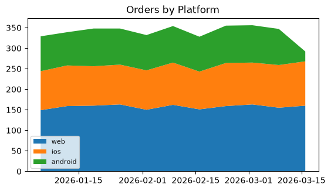

Stacked areas: only the bottom layer sits on a flat baseline, so the Android change at the top is hard to read.

#### After

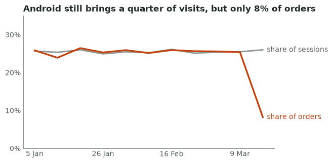

Two shares on one axis: Android still brings a quarter of the visits but no longer a quarter of the orders.

```python
rows = q("""
    SELECT week_start,
           SUM(sessions) FILTER (WHERE platform = 'android') / SUM(sessions) AS sessions_share,
           SUM(orders)   FILTER (WHERE platform = 'android') / SUM(orders)   AS orders_share
    FROM 'data/weekly_platform.csv' WHERE days_in_data = 7
    GROUP BY 1 ORDER BY 1""")
xs = [r[0] for r in rows]
fig, ax = plt.subplots(figsize=(6.4, 3.4))
ax.plot(xs, [r[1] for r in rows], color=GRAY, lw=2)
ax.plot(xs, [r[2] for r in rows], color=ACCENT, lw=2.4)
ax.text(xs[-1], rows[-1][1], "  share of sessions", color=MUTED, va="center")
ax.text(xs[-1], rows[-1][2], "  share of orders", color=ACCENT, va="center")
ax.set_ylim(0, 0.35)
ax.set_yticks([0, 0.1, 0.2, 0.3], ["0%", "10%", "20%", "30%"])
ax.set_xticks(xs[::3], [f"{x.day} {x:%b}" for x in xs[::3]])
ax.tick_params(length=0)
ax.set_title("Android still brings a quarter of visits, but only 8% of orders")
save(fig, "images/a7-comp-after.png")
print(f"Android, last complete week: {rows[-1][1]:.1%} of sessions, {rows[-1][2]:.1%} of orders")
```

Output:

```text
saved images/a7-comp-after.png
Android, last complete week: 26.0% of sessions, 8.2% of orders
```

**Distribution**

#### Before

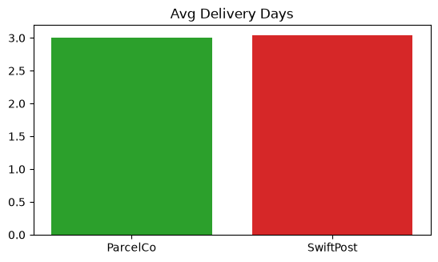

Two averages that look the same: the chart says “no difference”.

#### After

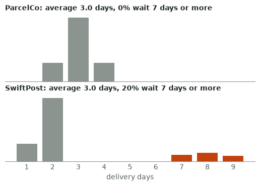

Two histograms on one x-axis: SwiftPost is often faster, and about 1 in 5 of its customers waits a week or more.

```python
ships = q("SELECT carrier, delivery_days FROM 'data/deliveries.csv'")
fig, axs = plt.subplots(2, 1, figsize=(6.4, 3.8), sharex=True)
for ax, carrier in zip(axs, ("ParcelCo", "SwiftPost")):
    days = [d for c, d in ships if c == carrier]
    counts = [days.count(k) for k in range(1, 10)]
    ax.bar(range(1, 10), counts, width=0.8,
           color=[ACCENT if k >= 7 else GRAY for k in range(1, 10)])
    ax.set_yticks([])
    ax.spines["left"].set_visible(False)
    ax.tick_params(length=0)
    late = sum(d >= 7 for d in days) / len(days)
    ax.set_title(f"{carrier}: average {sum(days) / len(days):.1f} days, "
                 f"{late:.0%} wait 7 days or more", fontsize=10)
    print(f"{carrier:9} mean {sum(days) / len(days):.2f}  7+ days {late:.1%}")
axs[1].set_xticks(range(1, 10))
axs[1].set_xlabel("delivery days")
save(fig, "images/a7-dist-after.png")
```

Output:

```text
ParcelCo  mean 3.00  7+ days 0.0%
SwiftPost mean 3.04  7+ days 20.5%
saved images/a7-dist-after.png
```

**Relationship**

#### Before

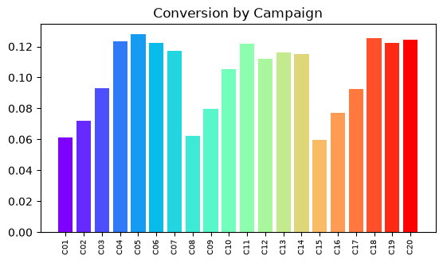

Bars in campaign-ID order: the IDs carry no meaning, so the pattern is invisible.

#### After

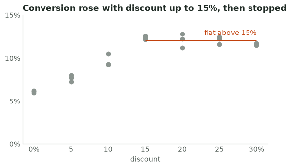

Discount on x, conversion on y: the rise and the plateau after 15 % are the message.

```python
camps = q("""SELECT discount_pct, orders / sessions FROM 'data/campaigns.csv'""")
fig, ax = plt.subplots(figsize=(6.4, 3.4))
ax.scatter([d for d, _ in camps], [c for _, c in camps], color=GRAY, s=36)
deep = [c for d, c in camps if d >= 15]
ax.hlines(sum(deep) / len(deep), 15, 30, color=ACCENT, lw=2)
ax.text(30, sum(deep) / len(deep) + 0.006, "flat above 15%", color=ACCENT, ha="right")
ax.set_xticks([0, 5, 10, 15, 20, 25, 30], ["0%", "5", "10", "15", "20", "25", "30%"])
ax.set_yticks([0, 0.05, 0.10, 0.15], ["0%", "5%", "10%", "15%"])
ax.set_xlabel("discount")
ax.tick_params(length=0)
ax.set_title("Conversion rose with discount up to 15%, then stopped")
save(fig, "images/a7-rel-after.png")
```

Output:

```text
saved images/a7-rel-after.png
```

<details><summary>How the three “before” charts were drawn</summary>

```python
with plt.style.context("default"):
    plat = q("""SELECT week_start, platform, orders FROM 'data/weekly_platform.csv'
                WHERE days_in_data = 7 ORDER BY week_start""")
    wk = sorted({w for w, _, _ in plat})
    fig, ax = plt.subplots(figsize=(6.4, 3.4))
    ax.stackplot(wk, *[[o for w, p, o in plat if p == name] for name in ("web", "ios", "android")],
                 labels=["web", "ios", "android"])
    ax.legend(loc="lower left", fontsize=8)
    ax.set_title("Orders by Platform")
    save(fig, "images/a7-comp-before.png")

    fig, ax = plt.subplots(figsize=(6.4, 3.4))
    avg = q("SELECT carrier, AVG(delivery_days) FROM 'data/deliveries.csv' GROUP BY 1 ORDER BY 1")
    ax.bar([c for c, _ in avg], [a for _, a in avg], color=["tab:green", "tab:red"])
    ax.set_title("Avg Delivery Days")
    save(fig, "images/a7-dist-before.png")

    fig, ax = plt.subplots(figsize=(6.4, 3.4))
    by_id = q("SELECT campaign_id, orders / sessions FROM 'data/campaigns.csv' ORDER BY 1")
    ax.bar([i for i, _ in by_id], [c for _, c in by_id], color=plt.cm.rainbow([k / 19 for k in range(20)]))
    ax.tick_params(axis="x", labelrotation=90, labelsize=7)
    ax.set_title("Conversion by Campaign")
    save(fig, "images/a7-rel-before.png")
```

Output:

```text
saved images/a7-comp-before.png
saved images/a7-dist-before.png
saved images/a7-rel-before.png
```

</details>

> **On the job:** These three show up in real reviews constantly: a mix-shift question (“is Android just a smaller share now?”, which the metric-diagnosis deck answered with a rate/mix split), an SLA question where the average is fine and customers are not, and a pricing question where someone wants to push discounts higher. The right chart answers each in one look.

> **The main idea:** shares over time are lines, spreads are histograms (never a lone average), relationships are scatter plots; each replaces a chart that hides the message.

*Read more:* [Financial Times: Visual Vocabulary](https://github.com/Financial-Times/chart-doctor/tree/main/visual-vocabulary), [UK Analysis Function: data visualisation, charts](https://analysisfunction.civilservice.gov.uk/policy-store/data-visualisation-charts/), [Small multiples](https://en.wikipedia.org/wiki/Small_multiple).

---

<a id="slide-8"></a>
## 8. Declutter: remove everything that does not carry data

*Part B · what can go, and in what order?*

**Clutter** is every mark on a chart that costs the reader attention without telling them anything: frames, heavy grids, tick marks, legends they must look up, decimals nobody needs. Edward Tufte called the share of ink that shows data the **data-ink ratio**, and decoration that shows nothing **chartjunk**. The practical reason to remove them is **cognitive load**: the mental effort a reader spends decoding the chart instead of understanding the data. Decluttering is a sequence you can apply to any chart, in any tool. The first two steps are the reusable helpers below; `STYLE` (lesson 2) already applies some of them to every chart.

```python
def declutter(ax, hide=()):
    """Remove what carries no data: box, tick marks, grid, legend frame.
    hide=("y",) also drops a value axis whose numbers are already written on the marks."""
    for side in ("top", "right"):
        ax.spines[side].set_visible(False)
    ax.tick_params(length=0)
    ax.grid(False)
    if "y" in hide:
        ax.spines["left"].set_visible(False)
        ax.set_yticks([])
    if "x" in hide:
        ax.spines["bottom"].set_visible(False)
        ax.set_xticks([])
    if ax.get_legend() is not None:
        ax.get_legend().remove()
    return ax


def label_end(ax, x, y, text, color, dy=0):
    """A direct label just right of the last point, in the line's colour: no legend lookup."""
    ax.annotate(text, (x, y), xytext=(6, dy), textcoords="offset points",
                va="center", color=color, fontsize=10, annotation_clip=False)
```

```python
conv = q("""SELECT platform, week_start, orders / sessions FROM 'data/weekly_platform.csv'
            WHERE days_in_data = 7 ORDER BY platform, week_start""")
series = {p: [(w, c) for pp, w, c in conv if pp == p] for p in ("web", "ios", "android")}

fig, axs = plt.subplots(2, 2, figsize=(11, 6.4))
for step, ax in enumerate(axs.flat, start=1):
    for p, pts in series.items():
        xs, ys = zip(*pts)
        color = (ACCENT if p == "android" else GRAY) if step == 4 else None
        ax.plot(xs, ys, label=p, color=color, marker="o" if step == 1 else None,
                lw=2.4 if step == 4 and p == "android" else 1.6)
    if step == 1:                                    # 1. what the defaults give you
        for spine in ax.spines.values():
            spine.set_visible(True)
        ax.grid(True)
        ax.legend(frameon=True)
        ax.set_title("1. Defaults: box, grid, markers, legend", fontsize=10)
        continue
    declutter(ax)                                    # 2. frame, grid, tick marks go
    ax.set_ylim(0, 0.2)
    ax.set_xticks(xs[::3], [f"{x.day} {x:%b}" for x in xs[::3]])
    if step == 2:
        ax.legend()
        ax.set_title("2. Remove the box, grid and tick marks", fontsize=10)
        continue
    ax.set_yticks([0, 0.1, 0.2], ["0%", "10%", "20%"])  # 3. readable axis, labels on the lines
    last = {p: pts[-1][1] for p, pts in series.items()}
    if step == 3:
        for p, dy in (("web", 6), ("ios", -6), ("android", 0)):
            label_end(ax, xs[-1], last[p], p, MUTED, dy)
        ax.set_title("3. Label the lines, format the axis", fontsize=10)
    else:                                            # 4. gray context, one accent, a message
        label_end(ax, xs[-1], last["android"], "Android", ACCENT)
        label_end(ax, xs[-1], (last["web"] + last["ios"]) / 2, "Web, iOS", MUTED)
        ax.set_title("4. Android conversion collapsed; web and iOS did not", fontsize=10)
fig.tight_layout()
save(fig, "images/b8-steps.png")
```

Output:

```text
saved images/b8-steps.png
```


| Remove | Keep (it carries data or context) |
|---|---|
| Box and background, heavy grid lines, tick marks | The zero baseline of bars; light grid lines only if readers must read exact values |
| Legends that force a lookup | Direct labels at the end of each line or on each bar |
| Markers on every point, data labels on every point | One highlighted point, or labels on the few values that matter |
| Decimals beyond what the decision needs; rotated text | Units (once, in the title or axis), scaled numbers such as $20K |
| 3D, shadows, gradients, decorative icons | Source, definition and freshness notes, in small muted text |

> **On the job:** In a review, “declutter” is the most common feedback and the cheapest to fix. Put the steps in a shared theme once (a matplotlib style, a Power BI report theme) so every new chart starts quiet, and spend review time on the message instead of the gridlines.

> **The main idea:** declutter in a fixed order (frame and grid, then legends and axes, then colour and title) until every remaining mark carries data or context.

*Read more:* [Chartjunk](https://en.wikipedia.org/wiki/Chartjunk), [Matplotlib: spines](https://matplotlib.org/stable/api/spines_api.html), [Storytelling with Data (blog and challenges)](https://www.storytellingwithdata.com/).

---

<a id="slide-9"></a>
## 9. Headline titles: say the finding, computed from the data

*Part B · what should the title say?*

A **topic title** names what is plotted (“Net sales by week”). A **headline title** (also called an action title) states what the reader should conclude (“Net sales fell 15 % week over week to $17.4K”). The **subtitle** underneath carries the definition, unit, population and period, in smaller muted text. Readers read the title first and often only the title, so it should do the work. A headline typed by hand goes stale at the next refresh; compute it from the same numbers the chart uses.

```python
def headline(metric, this, last, fmt=fmt_money, period="week over week"):
    """A title that states the finding, computed from the same numbers as the chart."""
    change = this / last - 1
    if abs(change) < 0.005:
        return f"{metric} was flat {period} at {fmt(this)}"
    verb = "rose" if change > 0 else "fell"
    return f"{metric} {verb} {abs(change):.0%} {period} to {fmt(this)}"


assert headline("Net sales", 17428.16, 20527.65) == "Net sales fell 15% week over week to $17.4K"
assert headline("Orders", 350, 347, fmt=str) == "Orders rose 1% week over week to 350"
assert headline("Orders", 348, 347, fmt=str) == "Orders was flat week over week at 348"
print(headline("Net sales", 17428.16, 20527.65))
```

Output:

```text
Net sales fell 15% week over week to $17.4K
```

The third test exposes a grammar wrinkle (“Orders was flat”): a generated headline is a template, so give it metric names that read well (“Order count was flat”) and test the edge cases, as here. Then use it as the chart title, with a subtitle for the definition:

#### Before

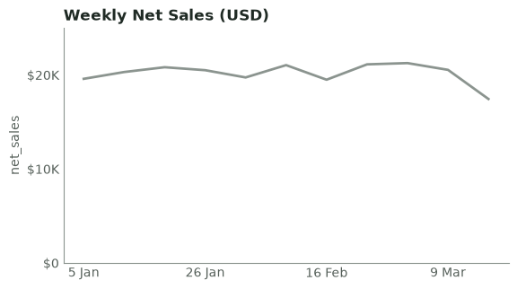

A topic title: the reader must work out the finding, and the chart does not say which weeks or which definition.

#### After

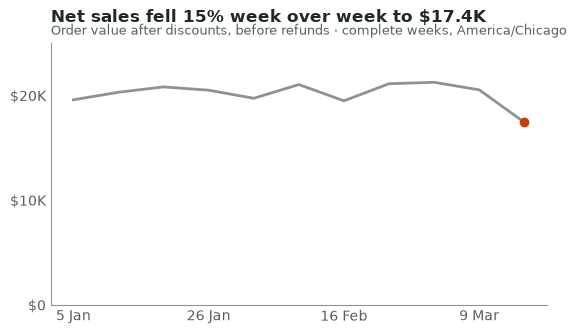

A computed headline, a subtitle with definition and period, the evidence highlighted.

```python
weeks = q("""SELECT week_start, SUM(net_sales) FROM 'data/weekly_platform.csv'
              WHERE days_in_data = 7 GROUP BY 1 ORDER BY 1""")
xs, ys = [w for w, _ in weeks], [s for _, s in weeks]
for name, title in (("before", "Weekly Net Sales (USD)"), ("after", headline("Net sales", ys[-1], ys[-2]))):
    fig, ax = plt.subplots(figsize=(6.4, 3.4))
    ax.plot(xs, ys, color=GRAY, lw=2)
    ax.set_ylim(0, 25000)
    ax.set_yticks([0, 10000, 20000], ["$0", "$10K", "$20K"])
    ax.set_xticks(xs[::3], [f"{x.day} {x:%b}" for x in xs[::3]])
    declutter(ax)
    if name == "before":
        ax.set_title(title)
        ax.set_ylabel("net_sales")
    else:
        ax.plot(xs[-1], ys[-1], "o", color=ACCENT)
        fig.suptitle(title, x=0.125, ha="left", fontsize=12, fontweight="bold", color=INK)
        ax.set_title("Order value after discounts, before refunds · complete weeks, America/Chicago",
                     fontsize=9, fontweight="normal", color=MUTED)
    save(fig, f"images/b9-{name}.png")
```

Output:

```text
saved images/b9-before.png
saved images/b9-after.png
```

| Use a… | When | Example |
|---|---|---|
| Headline title | The page exists to report a finding (WBR, incident, executive update) | “Net sales fell 15 % week over week to $17.4K” |
| Question title | A section that the reader explores with filters | “Which platform changed?” |
| Topic title + dynamic headline | Self-service pages whose finding changes with every filter | Topic title, plus a headline measure that recomputes (lesson 13) |

> **On the job:** The *Diagnosing metric changes* write-up starts with exactly this kind of sentence; on a dashboard, the same sentence becomes the page title. Generated headlines are also testable: the lab’s pytest checks that the headline agrees with the data, so a broken metric cannot hide behind an old title.

> **The main idea:** title = the finding, generated from the data and tested; subtitle = definition, unit and period; annotation = the evidence on the chart.

*Read more:* [Storytelling with Data (blog and challenges)](https://www.storytellingwithdata.com/), [Nielsen Norman Group: inverted pyramid](https://www.nngroup.com/articles/inverted-pyramid/), [Matplotlib: annotate](https://matplotlib.org/stable/api/_as_gen/matplotlib.axes.Axes.annotate.html).

---

<a id="slide-10"></a>
## 10. Colour and numbers with purpose

*Part B · what does each colour mean, and how many digits?*

A few visual properties, such as colour, size and position, are noticed before conscious attention: they are called **preattentive attributes**. That is why one orange line among gray ones is found instantly, and why seven bright colours make the eye search. Choose the palette type from the data: a **categorical palette** (distinct hues) for unordered groups, a **sequential palette** (light to dark) for ordered magnitudes, and a **diverging palette** (two hues from a neutral midpoint) for above/below a target. Two rules hold everywhere: gray is the default and an **accent colour** marks the point; and a colour means the same thing on every chart of the page.

```python
import matplotlib as mpl
palettes = {
    "gray + one accent": [GRAY, GRAY, ACCENT, GRAY, GRAY],
    "categorical (Okabe-Ito)": ["#E69F00", "#56B4E9", "#009E73", "#0072B2", "#D55E00", "#CC79A7"],
    "sequential (Greens)": [mpl.colormaps["Greens"](v) for v in (0.25, 0.4, 0.55, 0.7, 0.85)],
    "diverging (PuOr)": [mpl.colormaps["PuOr"](v) for v in (0.1, 0.3, 0.5, 0.7, 0.9)],
}
fig, ax = plt.subplots(figsize=(7.5, 2.6))
for row, (name, colors) in enumerate(palettes.items()):
    for k, c in enumerate(colors):
        ax.add_patch(mpl.patches.Rectangle((k, -row - 0.8), 0.92, 0.7, color=c))
    ax.text(-0.2, -row - 0.45, name, ha="right", va="center", color=INK)
ax.set_xlim(-0.1, 6)
ax.set_ylim(-len(palettes), 0)
ax.set_axis_off()
save(fig, "images/b10-palettes.png")

PLATFORM_COLOURS = {"web": GRAY, "ios": GRAY, "android": ACCENT}   # fixed, not by position
print(PLATFORM_COLOURS["android"])
```

Output:

```text
saved images/b10-palettes.png
#c2410c
```

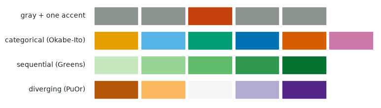

Numbers need the same discipline. Scale them (“$17.4K”, not “17428.16”), keep three or four significant digits, put the unit once, and show the change of a rate in **percentage points** (“▼2.6 pts”), because “conversion fell 17 %” and “conversion fell 2.6 points” describe the same move and readers confuse them.

```python
def fmt_money(x):
    """$17.4K, $1.2M, $640: scaled, three or four significant figures, sign in front."""
    sign, x = ("-" if x < 0 else ""), abs(x)
    for size, suffix in ((1e9, "B"), (1e6, "M"), (1e3, "K")):
        if round(x / size, 1) >= 1:          # round first: 999,950 must become $1.0M, not $1000.0K
            return f"{sign}${x / size:.1f}{suffix}"
    return f"{sign}${x:,.0f}"


def fmt_pct(x, nd=1):
    return f"{100 * x:.{nd}f}%"


def fmt_change(this, last, kind="relative"):
    """'▼15%' for a relative change, '▼2.6 pts' for a change in a rate: arrow + number, never colour alone."""
    if kind == "points":
        d, text = 100 * (this - last), f"{abs(100 * (this - last)):.1f} pts"
    else:
        d, text = 100 * (this / last - 1), f"{abs(100 * (this / last - 1)):.0f}%"
    arrow = "▲" if d > 0.05 else "▼" if d < -0.05 else "■"
    return arrow + text


for x in (17428.16, 999_950, 1_234_567, -640.4, 59.69):
    print(f"{x:>14,.2f} -> {fmt_money(x)}")
print(fmt_pct(0.12357), fmt_change(0.12357, 0.14931, "points"), fmt_change(17428.16, 20527.65))
assert fmt_money(999_950) == "$1.0M" and fmt_change(1.0, 1.0) == "■0%"
```

Output:

```text
     17,428.16 -> $17.4K
    999,950.00 -> $1.0M
  1,234,567.00 -> $1.2M
       -640.40 -> -$640
         59.69 -> $60
12.4% ▼2.6 pts ▼15%
```

> **On the job:** Colour by meaning, not by position: when a filter removes “web”, a colour assigned by order makes Android change from orange to blue between two screenshots in the same meeting. In Power BI, set data colours per category in the report theme or the format pane, and set number formats (display units, decimals) on the measure so every visual inherits them.

> **The main idea:** gray by default, one accent for the point, a fixed colour per category; numbers scaled, rounded once, and rate changes in points.

*Read more:* [Okabe and Ito: colour universal design](https://jfly.uni-koeln.de/color/), [Matplotlib: choosing colormaps](https://matplotlib.org/stable/users/explain/colors/colormaps.html), [UK Analysis Function: colours in charts](https://analysisfunction.civilservice.gov.uk/policy-store/data-visualisation-colours-in-charts/), [Stephen Few: practical rules for using colour (PDF)](https://www.perceptualedge.com/articles/visual_business_intelligence/rules_for_using_color.pdf).

---

<a id="slide-11"></a>
## 11. Headline-first dashboards: the inverted pyramid

*Part C · what goes where on the page?*

A **headline-first dashboard** is a page whose top-left element states the finding, with everything below it ordered by importance. It borrows the journalists’ **inverted pyramid**: conclusion first, evidence next, background last, so a reader who stops early still leaves with the point. Eye-tracking studies of screens show an **F-pattern**: people read the top lines left to right, then scan down the left edge. Put the headline where that scan starts and keep the most important tiles in the top rows.

```python
layout = [["headline"] * 4,
          ["k1", "k2", "k3", "k4"],
          ["driver", "driver", "split", "split"],
          ["detail", "detail", "notes", "notes"]]
text = {"headline": "1 · Headline sentence + why (subtitle: period, freshness, partial data)",
        "k1": "2 · KPI card", "k2": "KPI card", "k3": "KPI card", "k4": "KPI card",
        "driver": "3 · The chart that proves the headline\n(trend with the event annotated)",
        "split": "3 · Where it happened\n(the segment that moved)",
        "detail": "4 · Detail: breakdown or table", "notes": "4 · Definitions, links, owner"}
fig, axd = plt.subplot_mosaic(layout, figsize=(9, 5.4), height_ratios=[0.55, 0.9, 2.1, 1.3])
for name, ax in axd.items():
    ax.set_xticks([])
    ax.set_yticks([])
    for spine in ax.spines.values():
        spine.set_visible(True)
        spine.set_color(GRAY)
    ax.set_facecolor("#f4f6f4")
    ax.text(0.03, 0.5, text[name], transform=ax.transAxes, va="center", fontsize=9,
            color=ACCENT if name == "headline" else INK,
            fontweight="bold" if name == "headline" else "normal")
save(fig, "images/c11-wireframe.png")
```

Output:

```text
saved images/c11-wireframe.png
```

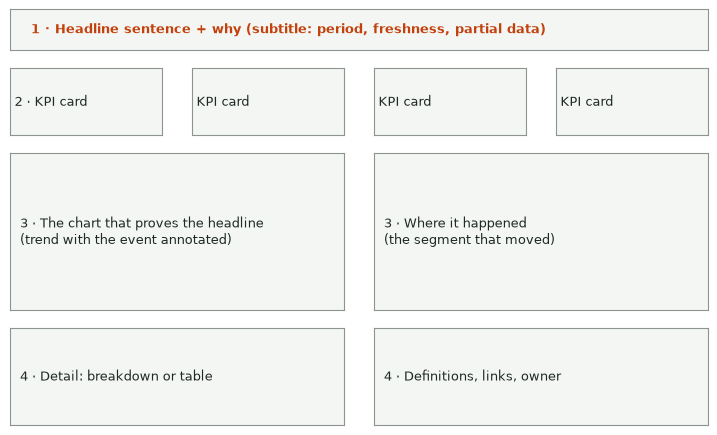

| Tier | What goes there | Example: Leafy’s operations page |
|---|---|---|
| 1 · Headline | One sentence with a number and a direction, then one sentence of cause; a subtitle with period, time zone and data freshness | “1 in 5 SwiftPost parcels took a week or more” · “ParcelCo had none; both average about 3 days” |
| 2 · KPI cards | 3–5 numbers the audience owns, each with a comparison | Parcels delivered within 4 days, share taking 7+ days, median days, delivery tickets |
| 3 · Drivers | One or two charts that prove the headline and locate it | Delivery-days histogram per carrier (lesson 7); weekly share of 7+ day parcels |
| 4 · Detail | Breakdowns, the formatted table, definitions, links, owner | Late parcels by region; the SLA definition; carrier contacts and the page owner |

Rules that keep the pyramid intact: **one page, one audience, one question** (leadership’s Monday question is not the operations team’s SLA question); tiers 1–3 fit on one screen without scrolling; no more than about six visuals; equal-sized tiles only when the items are equally important. The WBR table from *Diagnosing metric changes* belongs in tier 4 or on its own “numbers” page: it is for looking values up, the charts above it are for seeing the story.

> **On the job:** Sketch the four tiers on paper or in a slide before opening the BI tool, and show the sketch to the person who will read the page. Five minutes of “is this the question you ask on Monday?” saves the rebuild that usually follows a dashboard built from a list of requested metrics.

> **The main idea:** top-left states the finding; then KPI cards with comparisons, then the charts that prove and locate it, then detail. One page, one audience, one question.

*Read more:* [Nielsen Norman Group: F-shaped reading pattern](https://www.nngroup.com/articles/f-shaped-pattern-reading-web-content/), [Nielsen Norman Group: inverted pyramid](https://www.nngroup.com/articles/inverted-pyramid/), [Power BI: tips for designing a great dashboard](https://learn.microsoft.com/en-us/power-bi/create-reports/service-dashboards-design-tips), [Matplotlib: subplot_mosaic](https://matplotlib.org/stable/api/_as_gen/matplotlib.figure.Figure.subplot_mosaic.html).

---

<a id="slide-12"></a>
## 12. KPI cards and when a table wins

*Part C · what makes a number meaningful at a glance?*

A **KPI card** is a tile showing one key number. A number alone means nothing (“Net sales $17.4K”: good or bad?); a card needs four parts: a label, the value, the **change** with an arrow and words (never colour alone), and a **comparison** that gives it meaning: last period, the same period last year, a target, or the normal range (here the median of the previous eight weeks). A **sparkline** is a tiny line chart without axes that can sit next to the number to show its recent shape.

```python
def kpi_card(ax, label, value, change, note, bad=False):
    """Label, big number, change (arrow + words), and the comparison that gives it meaning."""
    ax.set_axis_off()
    put = lambda y, s, **kw: ax.text(0, y, s, transform=ax.transAxes, va="center", **kw)
    put(0.88, label.upper(), fontsize=9, color=MUTED)
    put(0.58, value, fontsize=22, fontweight="bold", color=INK)
    put(0.28, change, fontsize=11, color=ACCENT if bad else INK)
    put(0.06, note, fontsize=9, color=MUTED)


import statistics
weeks = q("""SELECT week_start, SUM(sessions), SUM(orders), SUM(net_sales)
              FROM 'data/weekly_platform.csv' WHERE days_in_data = 7 GROUP BY 1 ORDER BY 1""")
(_, s0, o0, n0), (_, s1, o1, n1) = weeks[-2], weeks[-1]
normal = statistics.median(r[3] for r in weeks[-9:-1])      # the 8 weeks before this one

fig, axs = plt.subplots(1, 4, figsize=(11, 1.7))
kpi_card(axs[0], "Net sales", fmt_money(n1), fmt_change(n1, n0) + " vs last week",
         f"8-week median {fmt_money(normal)}", bad=n1 < n0)
kpi_card(axs[1], "Orders", f"{o1:,}", fmt_change(o1, o0) + " vs last week", f"last week {o0:,}", bad=o1 < o0)
kpi_card(axs[2], "Session conversion", fmt_pct(o1 / s1), fmt_change(o1 / s1, o0 / s0, "points")
         + " vs last week", f"last week {fmt_pct(o0 / s0)}", bad=o1 / s1 < o0 / s0)
kpi_card(axs[3], "Average order value", f"${n1 / o1:,.2f}", fmt_change(n1 / o1, n0 / o0)
         + " vs last week", f"last week ${n0 / o0:,.2f}")
save(fig, "images/c12-after.png")
```

Output:

```text
saved images/c12-after.png
```

#### Before

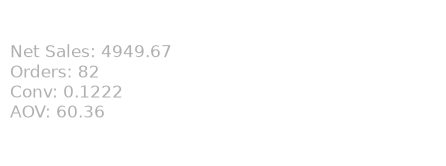

The current, partial week, raw decimals, no comparison, pale text: four numbers and zero meaning.

#### After

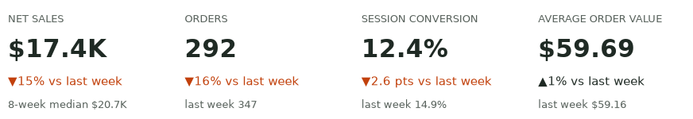

Complete week, scaled numbers, change with arrows, and a comparison under each value.

<details><summary>How the “before” tile was drawn</summary>

```python
with plt.style.context("default"):
    cur = q("""SELECT SUM(net_sales), SUM(orders), SUM(orders) / SUM(sessions),
                      SUM(net_sales) / SUM(orders)
               FROM 'data/weekly_platform.csv'
               WHERE week_start = (SELECT MAX(week_start) FROM 'data/weekly_platform.csv')""")[0]
    fig, ax = plt.subplots(figsize=(5.5, 1.9))
    ax.set_axis_off()
    ax.text(0, 0.5, "Net Sales: %.2f\nOrders: %d\nConv: %.4f\nAOV: %.2f" % cur,
            color="#b0b0b0", va="center", fontsize=12)
    save(fig, "images/c12-before.png")
```

Output:

```text
saved images/c12-before.png
```

</details>

**When a table wins:** a chart shows shape (trend, ranking, spread); a table lets readers look up exact values. When the audience compares many measures with different units and needs the exact numbers (the WBR meeting), a formatted table in a fixed order is the right visual. That table and its formatting rules are taught in *Diagnosing metric changes* (lab step 4); do not force those numbers into a chart.

> **On the job:** Most “the dashboard is wrong” tickets about KPI cards are really “the card has no comparison” or “the card shows the current, incomplete period”. Agree the comparison per KPI with the metric owner (it belongs in the metric spec card from *Metric design*) and filter cards to complete periods in the model, not by hand in each visual.

> **The main idea:** a KPI card = label + value + change (arrow and words) + comparison, on a complete period; use a table instead when readers need exact values for many measures.

*Read more:* [Power BI: card visuals](https://learn.microsoft.com/en-us/power-bi/visuals/power-bi-visualization-card), [Power BI: KPI visuals](https://learn.microsoft.com/en-us/power-bi/visuals/power-bi-visualization-kpi), [Sparklines](https://en.wikipedia.org/wiki/Sparkline).

---

<a id="slide-13"></a>
## 13. The same ideas in Power BI

*Part C · where is each idea in the tool you will use at work? (added)*

Everything in this deck is tool-independent; matplotlib only makes it visible and testable. In Power BI the same ideas live in the theme, the format pane and measures. Note one naming detail interviewers like: in Power BI a **report** is one or more interactive pages built in Desktop, while a Power BI **dashboard** is a single canvas of tiles pinned in the service. In everyday speech, people call both “dashboards”.

| Idea (lesson) | chartkit / matplotlib | Power BI |
|---|---|---|
| Quiet defaults (2, 8) | `STYLE` rcParams | A report theme (JSON): data colours, background, foreground, text sizes |
| Declutter (8) | `declutter(ax)` | Format pane: gridlines, borders, axis titles off; set once in the theme |
| Direct labels (8) | `label_end`, `bar_label` | Data labels; series labels on line charts |
| Headline title (9) | `headline(...)` | A measure that returns the sentence, bound to the visual title with conditional formatting (fx) |
| Fixed colour per category (10) | `PLATFORM_COLOURS` | Data colours per category in the theme or format pane |
| Number formats (10) | `fmt_money`, `fmt_change` | Format strings and display units on the measure |
| KPI cards (12) | `kpi_card(...)` | Card or KPI visual (value, trend axis, target) |
| Split by segment (7, 11) | one axes per platform, or highlighted lines | Small multiples field well |
| Annotation (6) | `ax.annotate` | Text box, or a constant line from the Analytics pane |
| Complete periods (14) | `WHERE days_in_data = 7` | An `is_complete_week` column in the model, used by report filters |
| Alt text (15) | `meta["alt_text"]` | Format → General → Alt text (250 characters), on every visual |

**Not executed — requires Power BI Desktop.** A dynamic headline measure, the DAX version of `headline()`. It assumes two measures you would already have: net sales for the last and the previous complete week.

```dax
Net sales headline =
VAR ThisWeek = [Net sales last complete week]
VAR LastWeek = [Net sales previous complete week]
VAR Change = DIVIDE ( ThisWeek - LastWeek, LastWeek )
VAR Amount = FORMAT ( ThisWeek / 1000, "$#,##0.0" ) & "K"
RETURN
    IF (
        ABS ( Change ) < 0.005,
        "Net sales was flat week over week at " & Amount,
        "Net sales " & IF ( Change > 0, "rose ", "fell " )
            & FORMAT ( ABS ( Change ), "0%" ) & " week over week to " & Amount
    )
```

**Not executed — requires Power BI Desktop.** The quiet palette as a report theme file (import it from the theme gallery):

```json
{
  "name": "Leafy quiet",
  "dataColors": ["#8b948f", "#c2410c", "#56605a", "#e3e7e4"],
  "background": "#FFFFFF",
  "foreground": "#1f2a24",
  "tableAccent": "#c2410c"
}
```

> **On the job:** A shared theme file and a headline measure are the two highest-leverage pieces of a BI team’s design system: every new report starts quiet, and every title is computed from the certified model. Both can live in Git next to the semantic model.

> **The main idea:** theme = STYLE, format pane = declutter, measures = headlines and number formats, Card/KPI visuals = KPI cards; learn the idea once, apply it in any tool.

*Read more:* [Power BI: report themes](https://learn.microsoft.com/en-us/power-bi/create-reports/desktop-report-themes), [Power BI: KPI visuals](https://learn.microsoft.com/en-us/power-bi/visuals/power-bi-visualization-kpi), [Power BI: small multiples](https://learn.microsoft.com/en-us/power-bi/visuals/power-bi-visualization-small-multiples), [Power BI: visualization types](https://learn.microsoft.com/en-us/power-bi/visuals/power-bi-visualization-types-for-reports-and-q-and-a).

---

<a id="slide-14"></a>
## 14. Misleading charts: honest numbers, false stories

*Part D · how can a correct number mislead?*

A misleading chart usually shows correct numbers: the distortion is in the drawing. Tufte’s **lie factor** measures it: the size of an effect as drawn divided by its size in the data (1 is honest). A **truncated axis** starts a bar’s value axis above zero; a **dual axis** (twin axis) draws two measures against two independent scales; a **partial period** is the current, incomplete day, week or month plotted as if it were complete.

**Truncated axis**

#### Before

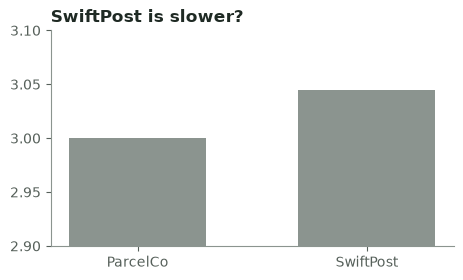

The axis starts at 2.9: a 1.5 % difference is drawn as a bar 45 % taller.

#### After

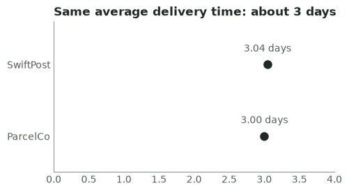

Zero baseline (or dots and a stated gap): the averages are the same; the real story is the tail in lesson 7.

```python
avg = dict(q("SELECT carrier, AVG(delivery_days) FROM 'data/deliveries.csv' GROUP BY 1"))
a, b = avg["ParcelCo"], avg["SwiftPost"]

def lie_factor(a, b, baseline):
    """Tufte: the size of the effect drawn, divided by the size of the effect in the data."""
    drawn = (b - baseline) / (a - baseline) - 1
    return drawn / (b / a - 1)

print(f"data: SwiftPost is {b / a - 1:.1%} slower; drawn from 2.9 it looks "
      f"{(b - 2.9) / (a - 2.9) - 1:.0%} taller; lie factor {lie_factor(a, b, 2.9):.0f}")

for name, lo in (("before", 2.9), ("after", 0)):
    fig, ax = plt.subplots(figsize=(5.2, 2.8))
    if name == "before":
        ax.bar(["ParcelCo", "SwiftPost"], [a, b], color=GRAY, width=0.6)
        ax.set_ylim(lo, 3.1)
        ax.set_title("SwiftPost is slower?")
    else:
        ax.plot([a, b], ["ParcelCo", "SwiftPost"], "o", color=INK, ms=8)
        for y, v in enumerate((a, b)):
            ax.text(v, y + 0.18, f"{v:.2f} days", ha="center", color=MUTED)
        ax.set_xlim(0, 4)
        ax.set_ylim(-0.5, 1.6)
        declutter(ax)
        ax.set_title("Same average delivery time: about 3 days")
    save(fig, f"images/d14-trunc-{name}.png")
```

Output:

```text
data: SwiftPost is 1.5% slower; drawn from 2.9 it looks 45% taller; lie factor 30
saved images/d14-trunc-before.png
saved images/d14-trunc-after.png
```

**Dual axis**

#### Before

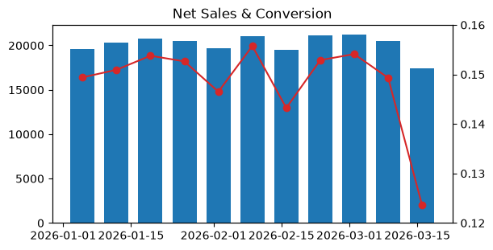

Two value axes with arbitrary ranges: where the line crosses the bars means nothing, and readers cannot tell which axis is which.

#### After

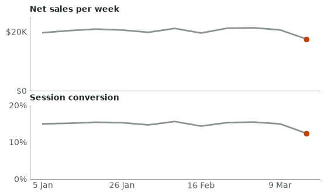

Two aligned panels on one time axis: each measure has its own honest scale, and the shared week shows they moved together.

```python
w = q("""SELECT week_start, SUM(net_sales), SUM(orders) / SUM(sessions)
          FROM 'data/weekly_platform.csv' WHERE days_in_data = 7 GROUP BY 1 ORDER BY 1""")
xs, sales, rate = [r[0] for r in w], [r[1] for r in w], [r[2] for r in w]

with plt.style.context("default"):
    fig, ax = plt.subplots(figsize=(6.4, 3.2))
    ax.bar(xs, sales, width=5, color="tab:blue")
    ax2 = ax.twinx()                                   # a second, independent value axis
    ax2.plot(xs, rate, color="tab:red", marker="o")
    ax2.set_ylim(0.12, 0.16)
    ax.set_title("Net Sales & Conversion")
    save(fig, "images/d14-dual-before.png")

fig, (top, bottom) = plt.subplots(2, 1, figsize=(6.4, 3.6), sharex=True)
top.plot(xs, sales, color=GRAY, lw=2)
top.set_ylim(0, 25000)
top.set_yticks([0, 20000], ["$0", "$20K"])
top.set_title("Net sales per week", fontsize=10)
bottom.plot(xs, rate, color=GRAY, lw=2)
bottom.set_ylim(0, 0.2)
bottom.set_yticks([0, 0.1, 0.2], ["0%", "10%", "20%"])
bottom.set_title("Session conversion", fontsize=10)
for ax, ys in ((top, sales), (bottom, rate)):
    ax.plot(xs[-1], ys[-1], "o", color=ACCENT)
    declutter(ax)
bottom.set_xticks(xs[::3], [f"{x.day} {x:%b}" for x in xs[::3]])
save(fig, "images/d14-dual-after.png")
```

Output:

```text
saved images/d14-dual-before.png
saved images/d14-dual-after.png
```

**Partial period (added)**

#### Before

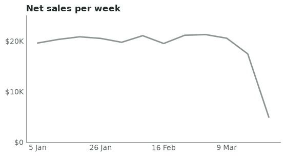

The last point is the current week with 2 of 7 days: it shows a 72 % “collapse” that has not happened.

#### After

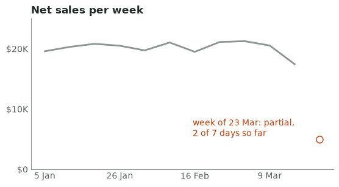

Complete weeks drawn solid; the partial week is a hollow, labelled marker (or left out).

```python
w = q("""SELECT week_start, MIN(days_in_data), SUM(net_sales)
          FROM 'data/weekly_platform.csv' GROUP BY 1 ORDER BY 1""")
naive = w[-1][2] / w[-2][2] - 1                      # MAX(week) vs the week before
done = [r for r in w if r[1] == 7]
right = done[-1][2] / done[-2][2] - 1                # last two complete weeks
print(f"naive change {naive:.0%} (partial week, {w[-1][1]} of 7 days); "
      f"complete weeks {right:.0%}")

for name in ("before", "after"):
    fig, ax = plt.subplots(figsize=(6.4, 3.2))
    rows = w if name == "before" else done
    ax.plot([r[0] for r in rows], [r[2] for r in rows], color=GRAY, lw=2)
    if name == "after":
        pw, days, value = w[-1]
        ax.plot(pw, value, "o", mfc="white", mec=ACCENT, ms=8)
        ax.annotate(f"week of {pw.day} {pw:%b}: partial,\n{days} of 7 days so far",
                    (pw, value), xytext=(-150, 4), textcoords="offset points", color=ACCENT)
    ax.set_ylim(0, 25000)
    ax.set_yticks([0, 10000, 20000], ["$0", "$10K", "$20K"])
    ax.set_xticks([r[0] for r in w[::3]], [f"{r[0].day} {r[0]:%b}" for r in w[::3]])
    declutter(ax)
    ax.set_title("Net sales per week")
    save(fig, f"images/d14-partial-{name}.png")
```

Output:

```text
naive change -72% (partial week, 2 of 7 days); complete weeks -15%
saved images/d14-partial-before.png
saved images/d14-partial-after.png
```

**When is a non-zero axis fine?** Bars encode the value as a length, so a bar must start at zero. Lines and dots encode it as a position, so a line or dot plot may zoom in when small changes matter (a conversion rate between 14 % and 16 %), as long as the axis is labelled and the zoom is stated.

| Also watch for | How it misleads | Fix |
|---|---|---|
| A cherry-picked window | Starting the chart at a peak or a trough makes any trend | Show a standard window (e.g. 13 weeks) and the same period last year |
| Cumulative totals | A running total always rises, hiding a weak month | Plot the per-period value; keep cumulative for targets |
| Bubbles sized by radius | Doubling the radius quadruples the area | Scale area to the value, or use bars |
| Different scales in small multiples | Panels look alike when they are not | Share the y-axis unless the shape is the message, and say so |
| Averages of ratios, changed denominators | The number on the chart answers a different question | Ratio of sums and a stated denominator (*Metric design*) |

> **On the job:** Partial periods cause more Monday-morning false alarms than any other chart problem: a dashboard filtered to “this week” on Tuesday shows a 70 % drop. Fix it in the model with a completeness flag or an `as_of` date, so every visual inherits the rule; the lab’s linter fails any page that plots an unlabelled partial week.

> **The main idea:** bars start at zero, each measure gets its own panel instead of a twin axis, and partial periods are excluded or clearly labelled; check the lie factor when in doubt.

*Read more:* [Misleading graph (overview with lie factor)](https://en.wikipedia.org/wiki/Misleading_graph), [UK Analysis Function: data visualisation, charts](https://analysisfunction.civilservice.gov.uk/policy-store/data-visualisation-charts/), [Power BI: tips for designing a great dashboard](https://learn.microsoft.com/en-us/power-bi/create-reports/service-dashboards-design-tips).

---

<a id="slide-15"></a>
## 15. Accessibility: contrast, colour and alt text

*Part D · can everyone read this chart?*

Accessible charts work for people with low vision, colour-vision deficiency, or a screen reader, and they also read better on a projector. Three WCAG 2.2 success criteria cover most chart problems: **1.4.3 contrast (minimum)**, text needs a contrast ratio of at least 4.5:1 with its background (3:1 for large text, 18 pt or 14 pt bold); **1.4.11 non-text contrast**, lines, bars and other marks a reader needs need 3:1; and **1.4.1 use of colour**, colour must not be the only way information is conveyed. The **contrast ratio** is computed from each colour’s **relative luminance** (its perceived brightness, 0 for black to 1 for white):

```python
from matplotlib.colors import to_rgb


def relative_luminance(color):
    """WCAG 2.2 relative luminance of any matplotlib colour (name, hex, or RGB tuple)."""
    def channel(c):
        return c / 12.92 if c <= 0.04045 else ((c + 0.055) / 1.055) ** 2.4
    r, g, b = (channel(c) for c in to_rgb(color))
    return 0.2126 * r + 0.7152 * g + 0.0722 * b


def contrast_ratio(fg, bg="white"):
    """1.0 (no contrast) to 21.0 (black on white). Text needs 4.5, large text and chart marks 3."""
    hi, lo = sorted((relative_luminance(fg), relative_luminance(bg)), reverse=True)
    return (hi + 0.05) / (lo + 0.05)


for name, c in (("INK", INK), ("MUTED", MUTED), ("GRAY", GRAY), ("ACCENT", ACCENT),
                ("pale gray #b0b0b0", "#b0b0b0"), ("pure green", "green"), ("pure red", "red")):
    r = contrast_ratio(c)
    verdict = "text" if r >= 4.5 else "marks/large text" if r >= 3 else "fails"
    print(f"{name:18} {r:5.2f}:1  {verdict}")
```

Output:

```text
INK                14.84:1  text
MUTED               6.53:1  text
GRAY                3.12:1  marks/large text
ACCENT              5.18:1  text
pale gray #b0b0b0   2.17:1  fails
pure green          5.14:1  text
pure red            4.00:1  marks/large text
```

That is why chartkit draws gray *lines* in `GRAY` (3.1:1, enough for marks) but gray *text* in `MUTED` (6.5:1). Colour-vision deficiency affects about 1 in 12 men and 1 in 200 women of Northern European ancestry, most often red/green. A quick, tool-free test: render the chart in grayscale. If the meaning disappears, it was carried by hue alone.

#### Before

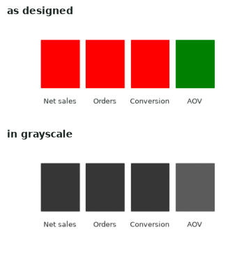

Status by red/green alone: in grayscale (and for many colour-blind readers) the tiles look the same.

#### After

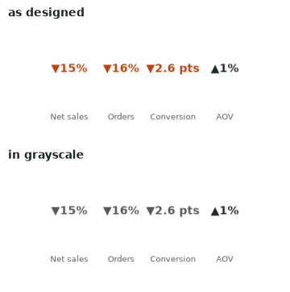

Arrow + number + words carry the meaning; colour only reinforces it, so grayscale loses nothing.

```python
import numpy as np
from matplotlib.patches import Rectangle

def grayscale_pair(draw, path):
    """Draw a chart, then show it next to its luminance-only (grayscale) version."""
    fig, ax = plt.subplots(figsize=(4.4, 1.9))
    draw(ax)
    fig.canvas.draw()
    rgb = np.asarray(fig.canvas.buffer_rgba())[..., :3] / 255
    plt.close(fig)
    gray = rgb @ [0.2126, 0.7152, 0.0722]               # the same weights as WCAG luminance
    out, (a, b) = plt.subplots(2, 1, figsize=(4.6, 4.2))   # stacked: shown at full size
    a.imshow(rgb)
    b.imshow(gray, cmap="gray", vmin=0, vmax=1)
    a.set_title("as designed", fontsize=10)
    b.set_title("in grayscale", fontsize=10)
    for x in (a, b):
        x.set_axis_off()
    save(out, path)

kpis = [("Net sales", "▼15%", False), ("Orders", "▼16%", False),
        ("Conversion", "▼2.6 pts", False), ("AOV", "▲1%", True)]

def status_only(ax):
    for i, (name, _, ok) in enumerate(kpis):
        ax.add_patch(Rectangle((i, 0.3), 0.85, 0.6, color="green" if ok else "red"))
        ax.text(i + 0.42, 0.1, name, ha="center", fontsize=9)
    ax.set_xlim(-0.1, 4)
    ax.set_axis_off()

def labelled(ax):
    for i, (name, change, ok) in enumerate(kpis):
        ax.text(i + 0.42, 0.62, change, ha="center", fontsize=13, fontweight="bold",
                color=INK if ok else ACCENT)
        ax.text(i + 0.42, 0.1, name, ha="center", fontsize=9, color=MUTED)
    ax.set_xlim(-0.1, 4)
    ax.set_axis_off()

grayscale_pair(status_only, "images/d15-before.png")
grayscale_pair(labelled, "images/d15-after.png")
```

Output:

```text
saved images/d15-before.png
saved images/d15-after.png
```

**Alt text** is the text a screen reader announces for an image or visual. Write the finding, not the chart type alone, and keep it short: Power BI limits a visual’s alt text to 250 characters. Generate it from the same numbers as the headline:

```python
w = q("""SELECT week_start, SUM(net_sales) FROM 'data/weekly_platform.csv'
          WHERE days_in_data = 7 GROUP BY 1 ORDER BY 1""")
before, last = [s for _, s in w[:-1]], w[-1]
alt = (f"Line chart. {headline('Net sales', last[1], w[-2][1])}. Weekly net sales stayed between "
       f"{fmt_money(min(before))} and {fmt_money(max(before))} for {len(before)} weeks, then fell "
       f"in the week of {last[0].day} {last[0]:%b} when Android app 5.3 shipped.")
assert 0 < len(alt) <= 250
print(len(alt), "characters:", alt)
```

Output:

```text
182 characters: Line chart. Net sales fell 15% week over week to $17.4K. Weekly net sales stayed between $19.5K and $21.2K for 10 weeks, then fell in the week of 16 Mar when Android app 5.3 shipped.
```

> **On the job:** Accessibility is a PL-300 objective and, in many organisations, a legal requirement for internal tools. In Power BI, set alt text and tab order on every visual, test with the high-contrast view and the “show data table” view (Alt+Shift+F11), and keep a theme whose text colours pass 4.5:1. Browser developer tools can also emulate colour-vision deficiencies on a published report.

> **The main idea:** text 4.5:1, marks 3:1, never colour alone (arrows, labels, words), and alt text that states the finding in under 250 characters.

*Read more:* [WCAG 2.2: contrast (minimum), 1.4.3](https://www.w3.org/WAI/WCAG22/Understanding/contrast-minimum.html), [WCAG 2.2: non-text contrast, 1.4.11](https://www.w3.org/WAI/WCAG22/Understanding/non-text-contrast.html), [WCAG 2.2: use of color, 1.4.1](https://www.w3.org/WAI/WCAG22/Understanding/use-of-color.html), [WCAG 2.2: relative luminance](https://www.w3.org/TR/WCAG22/#dfn-relative-luminance), [Power BI: design reports for accessibility](https://learn.microsoft.com/en-us/power-bi/create-reports/desktop-accessibility-creating-reports), [W3C WAI: complex images (charts)](https://www.w3.org/WAI/tutorials/images/complex/).

---

<a id="slide-16"></a>
## 16. The critique checklist, and a weekly habit

*Part D · how do you review any dashboard in 20 minutes?*

A **critique** is a structured review of a chart or page against explicit criteria, ending in fixes, not opinions. Walk the checklist in order: the first three items decide whether the page is useful and honest, the rest make it fast to read. The lab ships it as `critique_checklist.md`; items marked “partly” are checked by `dashlint.py`, the lab’s small linter.

| # | Item | Ask | Automated? |
|---|---|---|---|
| 1 | Purpose | Who reads it, when, for which decision? One page, one audience, one question? | no |
| 2 | Headline | Does the top-left text state the finding with a number and a direction? | partly |
| 3 | Honesty | Bars from zero, one value axis per chart, complete periods, fair window, right denominator? | partly |
| 4 | Chart fits the message | Comparison, trend, composition, distribution, relationship: right chart? No many-slice pies, no 3D | pies only |
| 5 | Context | Is every number compared with last period, a target or the normal range? | no |
| 6 | Clutter | Frames, grids, legends, labels on every point, rotated text, needless decimals? | no |
| 7 | Colour | Gray for context, one accent, the same colour means the same thing everywhere? | partly |
| 8 | Numbers | Scaled, consistent precision, units once, rate changes in points? | no |
| 9 | Accessibility | Text 4.5:1, marks 3:1, never colour alone, alt text, readable font size? | partly |
| 10 | Layout and next step | Headline → KPIs → drivers → detail; definitions and freshness visible; a next click? | no |

The linter is ordinary Python over the figure object, so it runs on any chart. Here it checks the two trend charts from lesson 6, rebuilt in memory:

```python
from dashlint import lint

w = q("""SELECT week_start, MIN(days_in_data), SUM(net_sales)
          FROM 'data/weekly_platform.csv' GROUP BY 1 ORDER BY 1""")
with plt.style.context("default"):
    fig, ax = plt.subplots()
    ax.bar([r[0] for r in w], [r[2] for r in w], width=5, color=plt.cm.tab20(range(len(w))))
    ax.set_title("Net Sales by Week")
before = lint(fig, {})
done = [r for r in w if r[1] == 7]
fig, ax = plt.subplots()
ax.plot([r[0] for r in done], [r[2] for r in done], color=GRAY)
ax.set_title(headline("Net sales", done[-1][2], done[-2][2]))
after = lint(fig, {"alt_text": "Line chart of weekly net sales; complete weeks only."})
for (name, ok_before, _), (_, ok_after, detail) in zip(before, after):
    print(f"{name:15} before {'PASS' if ok_before else 'FAIL'}   after {'PASS' if ok_after else 'FAIL'}")
plt.close("all")
```

Output:

```text
headline        before FAIL   after PASS
no_pie          before PASS   after PASS
bars_from_zero  before PASS   after PASS
no_dual_axis    before PASS   after PASS
partial_period  before FAIL   after PASS
colour_budget   before FAIL   after PASS
text_contrast   before PASS   after PASS
min_font        before PASS   after PASS
alt_text        before FAIL   after PASS
```

**The weekly habit** (the practice item “critique one dashboard per week”): spend 20 minutes on one public or work dashboard, for example a Makeover Monday chart, a Storytelling with Data challenge, a Power BI sample report, or your team’s own page. Walk the ten items, then write three lines in the log at the end of `critique_checklist.md`: the biggest problem (with its item number), the quickest fix, and the headline the page should have. Once a month, redesign one of them.

> **On the job:** Teams that review dashboards like code (a checklist in the pull request template, a linter in CI, a reviewer who signs off) ship fewer misleading pages. A senior candidate who says “I review dashboards with a checklist and automate what I can” sounds like someone who has owned production reporting.

> **The main idea:** critique in a fixed order, purpose and honesty first; automate the checkable half, and practise on one dashboard every week.

*Read more:* [Makeover Monday (weekly practice)](https://makeovermonday.co.uk/), [Storytelling with Data (blog and challenges)](https://www.storytellingwithdata.com/), [Tableau: dashboard best practices](https://help.tableau.com/current/pro/desktop/en-us/dashboards_best_practices.htm), [Stephen Few: dashboard design for real-time situation awareness (PDF)](https://www.perceptualedge.com/articles/Whitepapers/Dashboard_Design.pdf).

---

<a id="slide-17"></a>
## 17. Lab: critique and redesign Leafy’s weekly dashboard

*Lab · about 90 minutes, offline, in `dashboard-storytelling-lab/`*

**The brief.** Leafy’s leadership team opens this page every Monday at 9:00 to decide what needs attention this week. It is what the team shipped. Nobody noticed from it that net sales fell for a reason one team could fix the same day. Your job: critique it with the checklist, write the headline, lay out a headline-first page, build it, and make the automated checks pass. Then do the same once for your Fuel Smart page (lesson 21).

Terminal:

```text
$ python before_dashboard.py
saved out/before.png
```


| Step | You do | Time | Done when |
|---|---|---|---|
| 1 · Critique | Fill in the critique sheet in `critique_checklist.md`, then run `dashlint.py` | 20 min | At least 8 findings, each with an item number and a fix |
| 2 · Headline and wireframe | Compute the headline from complete weeks; add one sentence of cause; sketch the four tiers | 15 min | Two sentences and a sketch that a colleague understands in 10 seconds |
| 3 · Build and check | Write `my_redesign.py` with `build(data_dir="data") -> (fig, meta)`; run the linter and the tests | 45 min | `python dashlint.py my_redesign` prints 9 of 9 checks passed |
| 4 · Portfolio | Redesign the Fuel Smart page once (lesson 21) | 30 min | A headline-first page you would put in your README |

Files: `chartkit.py` (every helper from the lessons), `dashlint.py` (the automated half of the checklist), `before_dashboard.py`, `critique_checklist.md`, `solutions/` (spoilers), `tests/`. The lab’s [README](dashboard-storytelling-lab/README.md) repeats the brief and the commands.

> **On the job:** This is the most common real version of the task: not “build a dashboard” but “this dashboard is not working, fix it”. The order matters: critique against the reader’s decision first, then redesign. Redesigning before you know what is wrong usually reproduces the same problems in a new layout.

> **The main idea:** critique, then headline, then layout, then build, then check: the lab is the whole deck in one sequence.

*Read more:* [Power BI: tips for designing a great dashboard](https://learn.microsoft.com/en-us/power-bi/create-reports/service-dashboards-design-tips).

---

<a id="slide-18"></a>
## 18. Lab step 1: critique with the checklist

*Lab · step 1 · what is wrong, and which item does it break?*

Open the before page and walk the ten checklist items in order. For each problem, write the finding, the item number, why it matters to Monday’s reader, and a fix. Do it before running the linter: the point is to see what a human catches that a tool cannot.

<details><summary>Model critique (open after your attempt)</summary>

| Finding | Item | Fix |
|---|---|---|
| No headline: the title is “Leafy Weekly Dashboard v3 (FINAL)” in pale gray | 1, 2, 9 | A computed headline sentence top-left, in dark text |
| The KPI tile shows the current week, which has only 2 of 7 days | 3 | Complete weeks only; say so in the subtitle |
| KPIs have no comparison and raw decimals (0.1222…, 4949.67) | 5, 8 | KPI cards: scaled value, change with arrow, comparison |
| The net sales bars include the partial week: a fake 72 % collapse | 3 | Drop the partial week or label it |
| Conversion on a second y-axis from 0.12 to 0.16 | 3 | Its own panel, or a per-platform conversion chart |
| Orders by platform on an axis starting at 20; delivery averages on an axis starting at 2.9 | 3 | Bars from zero; for delivery, the distribution (and another page) |
| A 7-slice rainbow pie for channel mix | 4, 7 | Sorted bars with labels, gray |
| Stacked area of sessions: the platform that matters is not readable | 4 | Conversion by platform, Android highlighted |
| Rainbow and red/green colours with no meaning | 7, 9 | Gray + one accent; arrows and words for status |
| Six equal tiles, delivery next to sales: two audiences, no reading order | 1, 10 | Four tiers; delivery moves to the Operations page |
| Legends, gridlines, rotated 7 pt dates | 6, 9 | `declutter`, direct labels, readable sizes |

</details>

Terminal (exit code 1 is expected):

```text
$ python dashlint.py before_dashboard
FAIL headline         'Leafy Weekly Dashboard v3 (FINAL)'
FAIL no_pie           7 pie/donut wedges
FAIL bars_from_zero   Avg Delivery Days starts at 2.9; Orders by Platform starts at 20
FAIL no_dual_axis     'Net Sales & Conversion' has a twin axis
FAIL partial_period   a line plots the partial week of 2026-03-23 as if complete
FAIL colour_budget    9 distinct hues (limit 3)
FAIL text_contrast    3 low-contrast texts, e.g. 'Net Sales: 4949.67' 2.2:1, 'KPIs' 2.2:1
FAIL min_font         sizes below 8pt: [7.0]
FAIL alt_text         0 characters (1-250)
0 of 9 checks passed
[exit code 1]
```

The linter confirms nine problems in seconds. It cannot see the missing comparisons, the partial week inside a text tile, the mixed audiences, or the reading order: those are items 1, 5, 6, 8 and 10, and they are exactly the ones that decide whether the page is used.

> **On the job:** In a real review, lead with the two or three findings that change decisions (no headline, the fake collapse, the mixed audiences) and batch the cosmetic ones. A critique that starts with gridlines loses the room before it reaches the partial week.

> **The main idea:** critique by the checklist, rank findings by their effect on the decision, and use the linter to confirm, not replace, your judgement.

---

<a id="slide-19"></a>
## 19. Lab step 2: the headline and the wireframe

*Lab · step 2 · what should the page say first?*

Compute the headline from complete weeks with `headline()`; then find one sentence of cause in the data (which platform moved?) and write the subtitle: period, time zone, the partial-week note. Sketch the four tiers from lesson 11 with Leafy’s content. Five minutes of sketching saves an hour of moving tiles.

<details><summary>Reference headline and wireframe (open after your attempt)</summary>

```python
w = "'data/weekly_platform.csv'"
weeks = q(f"""SELECT week_start, SUM(net_sales) FROM {w}
              WHERE days_in_data = 7 GROUP BY 1 ORDER BY 1""")
(prev, n0), (last, n1) = weeks[-2], weeks[-1]
moves = q(f"""
    WITH c AS (SELECT platform, week_start, orders / sessions AS rate FROM {w})
    SELECT platform,
           MAX(rate) FILTER (WHERE week_start = '{prev}') AS before,
           MAX(rate) FILTER (WHERE week_start = '{last}') AS after
    FROM c GROUP BY platform ORDER BY after - before""")
platform, c0, c1 = moves[0]                         # the platform whose conversion moved most
print(headline("Net sales", n1, n0))
print(f"{platform.capitalize()} conversion fell from {fmt_pct(c0, 0)} to {fmt_pct(c1, 0)}; "
      + ", ".join(f"{p} {fmt_change(b, a, 'points')}" for p, a, b in moves[1:]))
```

Output:

```text
Net sales fell 15% week over week to $17.4K
Android conversion fell from 15% to 4%; ios ▲0.3 pts, web ▲0.4 pts
```

| Tier | Leafy’s Monday page |
|---|---|
| 1 · Headline | The two sentences above; subtitle: “Week of 16 Mar 2026 vs 9 Mar · complete weeks, America/Chicago · the partial week of 23 Mar is not shown” |
| 2 · KPI cards | Net sales, orders, session conversion, average order value: each with change and comparison (lesson 12) |
| 3 · Drivers | Net sales per week with “App 5.3 ships” annotated; session conversion by platform with Android in the accent colour |
| 4 · Detail | Orders by channel with the change (to show it is not a channel problem); definitions; “delivery moved to the Operations page” |

</details>

Note what the headline does not do: it does not blame, speculate or recommend. The action (“roll back 5.3”) belongs to the write-up taught in *Diagnosing metric changes*; the page’s job is to make the cause impossible to miss.

> **On the job:** Write the headline before choosing any chart. If you cannot write it, the page is not ready to build: either the analysis is unfinished, or the page is an exploration tool and should say so with a question title instead.

> **The main idea:** headline from complete weeks, cause from the segment that moved, subtitle for period and caveats, and a four-tier sketch before any code.

---

<a id="slide-20"></a>
## 20. Lab step 3: build the page and run the checks

*Lab · step 3 · does the redesign pass?*

Create `my_redesign.py` next to the other files. It must define `build(data_dir="data")` returning the figure and a `meta` dictionary with `alt_text`. Use `fig.subplot_mosaic` for the four tiers and the chartkit helpers for everything else. Then run `python dashlint.py my_redesign` and walk the manual checklist items again.

<details><summary>Reference solution: `solutions/redesign_solution.py` (open after your attempt)</summary>

The file below is the one executed by the next command; it is shown here for reading.

```python
"""Model redesign of Leafy's weekly dashboard (lab step 3). Open it only after your own attempt.

Run:  python -m solutions.redesign_solution      -> out/after.png
Check: python dashlint.py solutions.redesign_solution
"""
import statistics
import textwrap

from chartkit import (ACCENT, GRAY, INK, MUTED, declutter, fmt_change, fmt_money, fmt_pct,
                      headline, kpi_card, label_end, plt, q, save, use_style)


def load(data_dir="data"):
    w = f"'{data_dir}/weekly_platform.csv'"
    weeks = q(f"""SELECT week_start, SUM(sessions), SUM(orders), SUM(net_sales) FROM {w}
                  WHERE days_in_data = 7 GROUP BY 1 ORDER BY 1""")           # complete weeks only
    conv = q(f"""SELECT platform, week_start, orders / sessions FROM {w}
                 WHERE days_in_data = 7 ORDER BY platform, week_start""")
    (last, s1, o1, n1), (prev, s0, o0, n0) = weeks[-1], weeks[-2]
    chan = q(f"""SELECT channel,
                        SUM(orders) FILTER (WHERE week_start = '{last}') AS this_week,
                        SUM(orders) FILTER (WHERE week_start = '{prev}') AS last_week
                 FROM '{data_dir}/channel_orders.csv' GROUP BY 1 ORDER BY this_week, channel DESC""")
    partial = q(f"SELECT MIN(week_start), MIN(days_in_data) FROM {w} WHERE days_in_data < 7")[0]
    return dict(weeks=weeks, conv=conv, chan=chan, last=last, prev=prev, partial=partial,
                ns=(n0, n1), orders=(o0, o1), rate=(o0 / s0, o1 / s1), aov=(n0 / o0, n1 / o1),
                median_ns=statistics.median(r[3] for r in weeks[-9:-1]))


def build(data_dir="data"):
    use_style()
    d = load(data_dir)
    dm = lambda x: f"{x.day} {x:%b}"                # "9 Mar": day without a leading zero, on any OS
    android = {wk: r for p, wk, r in d["conv"] if p == "android"}
    a0, a1 = android[d["prev"]], android[d["last"]]
    title = headline("Net sales", d["ns"][1], d["ns"][0])
    why = (f"Android conversion fell from {fmt_pct(a0, 0)} to {fmt_pct(a1, 0)} after app 5.3 shipped on "
           f"Mon {dm(d['last'])}; web and iOS converted as usual.")

    fig = plt.figure(figsize=(12, 7.6))
    axd = fig.subplot_mosaic([["k1", "k2", "k3", "k4"], ["trend", "trend", "conv", "conv"],
                              ["chan", "chan", "notes", "notes"]],
                             height_ratios=[1, 2.3, 1.7], gridspec_kw=dict(hspace=0.55, wspace=0.35, left=0.055,
                                                                           right=0.95, top=0.80, bottom=0.04))
    fig.text(0.01, 0.975, title, fontsize=17, fontweight="bold", color=INK, va="top")
    fig.text(0.01, 0.925, why, fontsize=12, color=INK, va="top")
    fig.text(0.01, 0.885, f"Week of {dm(d['last'])} {d['last'].year} vs week of {dm(d['prev'])} · complete weeks, "
             f"America/Chicago · the partial week of {dm(d['partial'][0])} ({d['partial'][1]} of 7 days) is not shown",
             fontsize=9.5, color=MUTED, va="top")

    n0, n1 = d["ns"]
    kpi_card(axd["k1"], "Net sales", fmt_money(n1), fmt_change(n1, n0) + " vs last week",
             f"8-week median {fmt_money(d['median_ns'])}", bad=n1 < n0)
    o0, o1 = d["orders"]
    kpi_card(axd["k2"], "Orders", f"{o1:,}", fmt_change(o1, o0) + " vs last week", f"last week {o0:,}", bad=o1 < o0)
    r0, r1 = d["rate"]
    kpi_card(axd["k3"], "Session conversion", fmt_pct(r1), fmt_change(r1, r0, "points") + " vs last week",
             f"last week {fmt_pct(r0)}", bad=r1 < r0)
    v0, v1 = d["aov"]
    kpi_card(axd["k4"], "Average order value", f"${v1:,.2f}", fmt_change(v1, v0) + " vs last week",
             f"last week ${v0:,.2f}")

    ax = axd["trend"]
    xs, ys = [r[0] for r in d["weeks"]], [r[3] for r in d["weeks"]]
    ax.plot(xs, ys, color=GRAY, lw=2)
    ax.plot(xs[-1:], ys[-1:], "o", color=ACCENT, ms=7)
    ax.set_ylim(0, max(ys) * 1.2)
    ax.set_yticks([0, 10000, 20000], ["$0", "$10K", "$20K"])
    ax.set_xticks(xs[::2], [dm(x) for x in xs[::2]])
    ax.annotate("App 5.3 ships", (xs[-1], ys[-1]), xytext=(-110, -38), textcoords="offset points",
                color=ACCENT, fontsize=10, arrowprops=dict(arrowstyle="-", color=ACCENT))
    ax.set_title("Net sales per week")
    declutter(ax)

    ax = axd["conv"]
    for p in ("web", "ios", "android"):
        pts = [(wk, r) for pp, wk, r in d["conv"] if pp == p]
        ax.plot([a for a, _ in pts], [b for _, b in pts], color=ACCENT if p == "android" else GRAY,
                lw=2.4 if p == "android" else 1.6)
    label_end(ax, xs[-1], a1, "Android", ACCENT)
    web_ios = [r for pp, wk, r in d["conv"] if wk == d["last"] and pp != "android"]
    label_end(ax, xs[-1], sum(web_ios) / 2, "Web, iOS", MUTED)
    ax.set_ylim(0, 0.2)
    ax.set_yticks([0, 0.1, 0.2], ["0%", "10%", "20%"])
    ax.set_xticks(xs[::3], [dm(x) for x in xs[::3]])
    ax.set_title("Session conversion by platform")
    declutter(ax)

    ax = axd["chan"]
    names = [c for c, _, _ in d["chan"]]
    bars = ax.barh(names, [t for _, t, _ in d["chan"]], color=GRAY, height=0.6)
    ax.bar_label(bars, [f"{t}  ({t - l:+d})" for _, t, l in d["chan"]], padding=4, color=INK, fontsize=9)
    ax.set_title("Orders by channel this week (change vs last week)")
    declutter(ax, hide=("x",))
    ax.tick_params(axis="y", labelsize=9)

    ax = axd["notes"]
    ax.set_axis_off()
    ax.text(0, 1, "How to read this page", fontsize=10, fontweight="bold", color=INK, va="top")
    ax.text(0, 0.80, "• Net sales: order value after discounts, before refunds.\n"
                     "• Session conversion: orders ÷ sessions (bots and staff excluded).\n"
                     "• Every channel fell: the drop is not one channel's problem.\n"
                     "• Delivery metrics moved to the Operations page.\n"
                     "• Definitions: Leafy metric spec cards (Metric design deck).",
            fontsize=9.5, color=MUTED, va="top", linespacing=1.6)

    alt = (f"Leafy weekly dashboard. {title}. Android conversion fell from {fmt_pct(a0, 0)} to "
           f"{fmt_pct(a1, 0)} after app 5.3; web and iOS steady near 15%. Net sales were near "
           f"{fmt_money(d['median_ns'])} for the eight weeks before.")
    return fig, {"alt_text": alt, "headline": title}


if __name__ == "__main__":
    fig, meta = build()
    save(fig, "out/after.png", dpi=90)
    print(f"alt text ({len(meta['alt_text'])} characters):")
    print(textwrap.fill(meta["alt_text"], 88))
```

</details>

Terminal:

```text
$ python -m solutions.redesign_solution
saved out/after.png
alt text (206 characters):
Leafy weekly dashboard. Net sales fell 15% week over week to $17.4K. Android conversion
fell from 15% to 4% after app 5.3; web and iOS steady near 15%. Net sales were near
$20.7K for the eight weeks before.
```


#### The automated checks

Terminal:

```text
$ python dashlint.py solutions.redesign_solution
PASS headline         'Net sales fell 15% week over week to $17.4K'
PASS no_pie           0 pie/donut wedges
PASS bars_from_zero   all bar axes include zero
PASS no_dual_axis     one value axis per plot
PASS partial_period   partial week of 2026-03-23 not plotted
PASS colour_budget    1 distinct hues (limit 3)
PASS text_contrast    all text at least 4.5:1 (3:1 large)
PASS min_font         all text 8pt or larger
PASS alt_text         206 characters (1-250)
9 of 9 checks passed
```

#### The lab’s tests

Terminal (timing measured on the build machine):

```text
$ python -m pytest -q
........                                                                 [100%]
8 passed in 4.01s
```

The tests prove the linter fails all nine checks on the before page, passes all nine on the redesign, and that the headline agrees with the data.

**Expected results:** your page passes 9 of 9 automated checks; its headline names the drop and the platform; a colleague who sees it for five seconds can say what happened and where. If your layout differs from the reference, that is fine: the checklist, not the reference, is the standard.

> **On the job:** The pattern (a build function, a linter, a test that ties the headline to the data) is how a BI team keeps dashboards honest as data changes: the same checks run on every refresh or pull request, not once at launch.

> **The main idea:** a redesign is done when the linter passes, the manual items are walked, and a five-second glance gives the right story.

---

<a id="slide-21"></a>
## 21. In your portfolio: redesign the Fuel Smart page once

*Lab · step 4 · the practice item “redesign the portfolio dashboard once”*

Fuel Smart v1 asks: *which simple recipes give the most protein and fibre per calorie and contain the most vegetables, and do reviewers rate them as highly as other recipes?* First portfolio dashboards usually show everything they computed. Redesign yours once, headline first. Until your real mart exists, practise on `data/fuel_smart_recipes.csv`: 50 **synthetic** recipe servings with the mart’s shape (not real data, so the numbers below say nothing about real recipes).

#### Before

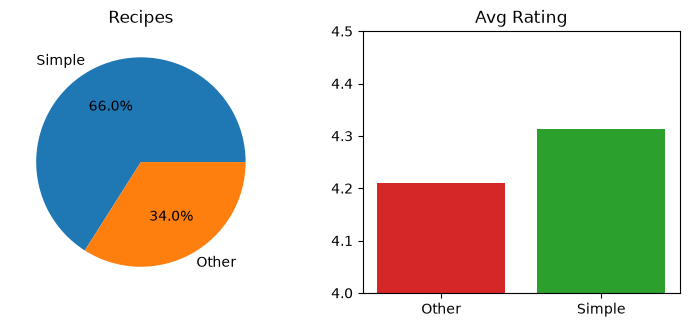

A pie that answers no question, and average ratings on a truncated axis that include recipes with zero to three reviews.

#### After

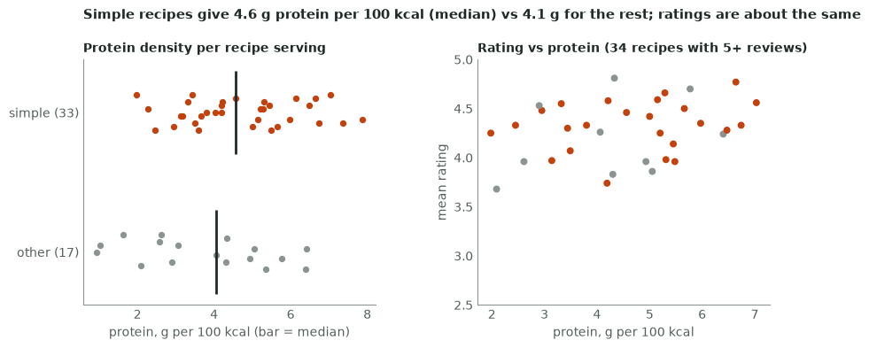

A headline from the data; a distribution for the nutrition question; a relationship chart for the rating question, with the minimum review count stated.

```python
import statistics
recipes = q("""SELECT is_simple, protein_g_per_100kcal, n_reviews, rating_mean
               FROM 'data/fuel_smart_recipes.csv'""")
simple = [p for s, p, _, _ in recipes if s == 1]
other = [p for s, p, _, _ in recipes if s == 0]
rated = [(s, p, r) for s, p, n, r in recipes if n >= 5]          # enough reviews to compare
r_s = statistics.mean(r for s, _, r in rated if s == 1)
r_o = statistics.mean(r for s, _, r in rated if s == 0)
m_s, m_o = statistics.median(simple), statistics.median(other)
title = (f"Simple recipes give {m_s:.1f} g protein per 100 kcal (median) vs {m_o:.1f} g for the rest; "
         + ("ratings are about the same" if abs(r_s - r_o) < 0.15 else "ratings differ"))
print(title)
print(f"rated recipes (5+ reviews): {len(rated)} of {len(recipes)}; mean rating {r_s:.2f} vs {r_o:.2f}")

fig, (a, b) = plt.subplots(1, 2, figsize=(10, 3.6), gridspec_kw=dict(wspace=0.35))
for y, (name, vals) in enumerate((("other", other), ("simple", simple))):
    jitter = [y + ((i * 7) % 11 - 5) / 40 for i in range(len(vals))]   # deterministic spread
    a.scatter(vals, jitter, s=18, color=ACCENT if name == "simple" else GRAY)
    a.vlines(statistics.median(vals), y - 0.3, y + 0.3, color=INK, lw=2)
a.set_yticks([0, 1], [f"other ({len(other)})", f"simple ({len(simple)})"])
a.set_xlabel("protein, g per 100 kcal (bar = median)")
a.set_title("Protein density per recipe serving", fontsize=10)
b.scatter([p for s, p, _ in rated], [r for s, _, r in rated], s=22,
          color=[ACCENT if s == 1 else GRAY for s, _, _ in rated])
b.set_ylim(2.5, 5)
b.set_xlabel("protein, g per 100 kcal")
b.set_ylabel("mean rating")
b.set_title(f"Rating vs protein ({len(rated)} recipes with 5+ reviews)", fontsize=10)
for ax in (a, b):
    declutter(ax)
fig.suptitle(title, x=0.125, y=1.04, ha="left", fontsize=11, fontweight="bold", color=INK)
save(fig, "images/p21-after.png")
```

Output:

```text
Simple recipes give 4.6 g protein per 100 kcal (median) vs 4.1 g for the rest; ratings are about the same
rated recipes (5+ reviews): 34 of 50; mean rating 4.33 vs 4.18
saved images/p21-after.png
```

<details><summary>How the “before” draft was drawn</summary>

```python
with plt.style.context("default"):
    fig, (a, b) = plt.subplots(1, 2, figsize=(9, 3.4))
    a.pie([len(simple), len(other)], labels=["Simple", "Other"], autopct="%1.1f%%")
    a.set_title("Recipes")
    avg = q("""SELECT is_simple, AVG(rating_mean) FROM 'data/fuel_smart_recipes.csv'
               WHERE n_reviews > 0 GROUP BY 1 ORDER BY 1""")
    b.bar(["Other", "Simple"], [r for _, r in avg], color=["tab:red", "tab:green"])
    b.set_ylim(4, 4.5)
    b.set_title("Avg Rating")
    save(fig, "images/p21-before.png")
```

Output:

```text
saved images/p21-before.png
```

</details>

Two rules carry over to your real page: compare ratings only for recipes with enough reviews and print that count on the chart, and state that the metrics describe recipe data, not personal health advice. Put the redesigned PNG and its alt text in your README: it is the first thing a reviewer of your portfolio will see.

> **On the job:** Hiring managers skim a portfolio in a minute or two. A README that opens with one headline-first chart (“Simple recipes give more protein per 100 kcal and rate the same”) shows the whole analytics-engineering loop: a precise metric, an honest chart, and a finding.

> **The main idea:** redesign your portfolio page once, headline first: a distribution for the nutrition question, a relationship for the rating question, with sample sizes on the chart.

*Read more:* [Small multiples](https://en.wikipedia.org/wiki/Small_multiple), [Storytelling with Data (blog and challenges)](https://www.storytellingwithdata.com/).

---

<a id="slide-22"></a>
## 22. Bug clinic: believable chart and dashboard bugs

*Practice · symptom → cause → fix*

#### Bug 1: the title says “rose”, the data says “fell”

```python
title = "Net sales rose 4% week over week"     # typed during last week's review
assert title == headline("Net sales", 17428.16, 20527.65)
```

Output:

```text
AssertionError: 
```

**Cause:** a headline typed by hand outlived the refresh. **Fix:** compute it with `headline()` (or a DAX measure) and test it against the data, as the lab does.

#### Bug 2: “$1000.0K” on the CEO’s card

```python
def fmt_money_naive(x):
    return f"${x / 1000:.1f}K" if x >= 1000 else f"${x:.0f}"
print(fmt_money_naive(999_950), fmt_money_naive(1_234_567), fmt_money_naive(-640))
print(fmt_money(999_950), fmt_money(1_234_567), fmt_money(-640))
```

Output:

```text
$1000.0K $1234.6K $-640
$1.0M $1.2M -$640
```

**Cause:** the unit is chosen before rounding, there is no millions branch, and the sign lands after the dollar. **Fix:** round first, then pick the unit; test the boundaries.

#### Bug 3: Android changes colour when a filter is applied

```python
def colours_by_position(platforms):
    return dict(zip(platforms, [GRAY, MUTED, ACCENT]))
print(colours_by_position(["web", "ios", "android"])["android"],
      colours_by_position(["ios", "android"])["android"])
```

Output:

```text
#c2410c #56605a
```

**Cause:** colours assigned by position shift when a category disappears. **Fix:** a fixed mapping such as `{"android": ACCENT, ...}`, or per-category data colours in the Power BI theme.

#### Bug 4: two channels swap places between refreshes

```python
rows = q("""SELECT channel, orders FROM 'data/channel_orders.csv'
            WHERE week_start = '2026-03-16' ORDER BY orders DESC""")
print([r for r in rows if r[1] == 54])
```

Output:

```text
[('Email', 54), ('Paid search', 54)]
```

**Cause:** SQL guarantees no order among ties, so Email and Paid search can swap between runs or engines and the chart “changes” with no data change. **Fix:** a tie-breaker, `ORDER BY orders DESC, channel`.

#### Bug 5: the nightly chart job runs out of memory

```python
import warnings
with warnings.catch_warnings(record=True) as caught:
    warnings.simplefilter("always")
    figs = [plt.figure() for _ in range(21)]          # one per report, never closed
print(len(plt.get_fignums()), "open figures;", caught[-1].category.__name__)
plt.close("all")
```

Output:

```text
21 open figures; RuntimeWarning
```

**Cause:** pyplot keeps every figure alive until it is closed; matplotlib warns after 20. **Fix:** close each figure after saving (chartkit’s `save()` does), or create figures with `matplotlib.figure.Figure` directly.

#### Bug 6: the date labels crash on the Windows build agent

```python
from datetime import date
print(f"{date(2026, 3, 9):%-d %b}")
```

Output:

```text
ValueError: Invalid format string
```

**Cause:** `%-d` (“day without leading zero”) is a glibc extension; Windows’ C library rejects it. **Fix:** `f"{d.day} {d:%b}"`, which works everywhere.

> **On the job:** Bugs 1 and 4 are the ones that erode trust: a stakeholder notices that the title contradicts the chart, or that the ranking changed while the numbers did not, and stops believing the page. Both are cheap to test.

> **The main idea:** generate titles and formats from the data, fix colours and sort orders explicitly, close what you open, and avoid platform-specific format codes.

---

<a id="slide-23"></a>
## 23. Interview questions and model answers

*Practice · say each answer aloud before revealing it*

Say each answer aloud in about 60 seconds before opening it. Questions are original, built on patterns researched in October 2026 (chart choice, critique, misleading charts, two scales, design process, accessibility, “too complex”).

<details><summary>“How do you choose which chart to use?” · checks: a process, not a list of chart names</summary>

**Model answer (about 60 s):** I start from the message: the one sentence the reader should take away, and the decision behind it. Then I classify it: comparison or ranking, trend, composition, distribution, or relationship. Each has a default: sorted bars, a line, a 100 % bar or share lines, a histogram, a scatter plot. I prefer encodings people read accurately, position on a shared axis first, then length; angle and area last. Finally I check the chart against the audience and the honesty rules, and I put the message in the title.

**Likely follow-up:** “And if the stakeholder insists on a pie?” → For two or three parts of a whole a pie is fine; otherwise I show both side by side for one review and let the bar chart win on how fast people answer “which is bigger?”.

</details>

<details><summary>“What is wrong with pie charts?” · checks: encoding accuracy, not taste</summary>

**Model answer (about 60 s):** A pie encodes values as angles and areas, which people compare less accurately than lengths on a common baseline. With many or similar slices the reader cannot rank them, and needs a legend lookup for every colour. They are acceptable for a simple part-to-whole with two or three parts. For comparisons, sorted bars with labels are faster and more accurate.

**Likely follow-up:** “What about donut or gauge charts?” → Same problem: angles. A gauge can show progress to a single goal, but a KPI card with value, target and change usually says it in less space.

</details>

<details><summary>“Here is a dashboard. How would you critique it?” · checks: a structured walk, prioritised</summary>

**Model answer (about 60 s):** I go in a fixed order. Purpose: who reads it, for which decision, one audience per page? Headline: does the top-left say the finding? Honesty: bars from zero, no twin axes, complete periods, fair windows, right denominators. Then chart fit, context for every number, clutter, colour, number formats, accessibility, and layout. I rank findings by their effect on the decision, so the fake drop from a partial week comes before gridlines, and I end with the headline the page should have.

**Likely follow-up:** “What would you change first?” → The finding that changes decisions: usually the missing headline or a misleading period. Cosmetic fixes come last.

</details>

<details><summary>“How can a chart be misleading even if the numbers are right?” · checks: naming patterns and fixes</summary>

**Model answer (about 60 s):** Truncated bar axes exaggerate differences (Tufte’s lie factor quantifies it); twin axes let you make any two lines cross; partial periods look like collapses; a cherry-picked start date manufactures a trend; cumulative totals hide declines; bubbles scaled by radius exaggerate; inconsistent scales across small multiples make different things look alike. Each has a fix: zero baselines for bars, separate aligned panels, complete periods, standard windows.

**Likely follow-up:** “Is a non-zero axis ever OK?” → For lines and dot plots, yes, when small changes matter and the axis is clearly labelled; position, not length, carries the value. For bars, no.

</details>

<details><summary>“How would you show two measures with different scales?” · checks: avoiding dual axes</summary>

**Model answer (about 60 s):** My default is two aligned panels that share the x-axis, each with its own honest scale. If the relationship between the two is the message, a scatter plot of one against the other. If I need them on one axis, I index both to 100 at a start date. I avoid twin y-axes because the scales are arbitrary, crossings mean nothing, and readers mix up which axis is which.

**Likely follow-up:** “The executive wants them on one chart.” → Indexed to 100 on one axis, or two panels placed tightly together so it reads as one chart.

</details>

<details><summary>“How do you design a dashboard from scratch?” · checks: audience and decision first, headline-first layout</summary>

**Model answer (about 60 s):** I ask who uses it, when, and what decision it supports, and I write the questions it must answer. For each, I agree the metric definition and the comparison. Then I sketch the inverted pyramid: headline sentence top-left, three to five KPI cards with comparisons, one or two charts that prove and locate the change, and detail plus definitions at the bottom. I review the sketch with the reader before building, and I add checks: complete periods, generated titles, contrast.

**Likely follow-up:** “How do you know it works?” → Usage (who opens it, how often), and whether the Monday meeting uses it to decide; I ask two readers to tell me the story after five seconds.

</details>

<details><summary>“How do you make a report accessible?” · checks: PL-300 knowledge and WCAG numbers</summary>

**Model answer (about 60 s):** Text contrast at least 4.5:1 (3:1 for large text) and 3:1 for marks the reader needs; never colour as the only signal, so status gets arrows and words; colour-blind-safe palettes; alt text on every visual that states the finding (Power BI allows 250 characters); a sensible tab order and titles; readable font sizes. I test with the high-contrast view, the show-data-table view and a grayscale check.

**Likely follow-up:** “Red/green status is our brand standard.” → Keep the colours but add shape and text (▲▼ and the number), and pick a red and green that differ in lightness, so the meaning survives without hue.

</details>

<details><summary>“Stakeholders say the dashboard is too complex. What do you do?” · checks: decluttering and prioritising, behavioural</summary>

**Model answer (about 60 s):** I find out which decision they use it for, then cut the page to that question: one audience per page, a headline, three to five KPIs with comparisons, the charts that prove the story, and everything else moved to detail pages or drill-throughs. I declutter in a fixed order and measure the result: fewer visuals, faster answers in a five-second test, and usage after two weeks.

**Likely follow-up:** “They want every metric on one page.” → Offer the full table as a separate “numbers” page (like a WBR table) and keep the main page for the story.

</details>

> **The main idea:** every answer starts from the reader’s decision, names the rule (encoding, honesty, accessibility), and ends with a concrete fix.

*Read more:* [GeeksforGeeks: data visualization interview questions (practice)](https://www.geeksforgeeks.org/data-visualization/data-visualization-interview-questions/), [Credmark: analytics dashboard interview questions (practice)](https://credmark.ai/practice/top-analytics-dashboard-interview-questions-and-answers), [Exam PL-300 study guide](https://learn.microsoft.com/en-us/credentials/certifications/resources/study-guides/pl-300).

---

<a id="slide-24"></a>
## 24. Exercises 1–4 · choose, predict, declutter, headline

*Exercises · warm-ups first, then interview level*

Exercises use the Leafy dashboard extract (lesson 3) and the chartkit helpers. Write your answer first; hints and solutions are collapsed (the Markdown companion puts them in Appendices A and B). Every solution ran during the build and its `assert` lines passed.

### Exercise 1 · Match the message to the chart

For each Leafy message, name the message type (comparison, trend, composition, distribution, relationship, deviation) and the default chart. (a) “Email overtook Paid search as our second-biggest channel.” (b) “Weekly orders grew six weeks in a row.” (c) “App orders are now 40 % of all orders, up from 30 % in January.” (d) “Half of tickets are answered within 2 hours, but 1 in 10 waits a day.” (e) “Customers who read a care guide reorder more often.” (f) “Three of five regions missed the delivery target.” Pattern: which chart and why · about 5 min.

*Hint: [Appendix A](#hint-1) · Solution: [Appendix B](#solution-1)*

### Exercise 2 · Predict what the pie asks the reader to judge

This week’s channel orders are 71, 54, 54, 41, 31, 23 and 18. Predict, without code: the angles of the Direct and Social slices, and whether a reader could see that Email and Paid search tie in a pie. Then check with code. Pattern: predict the output · about 5 min.

*Hint: [Appendix A](#hint-2) · Solution: [Appendix B](#solution-2)*

### Exercise 3 · Replace a legend with direct labels

Write `legend_to_labels(ax)`: remove the legend and write each line’s label just right of its last point, in the line’s colour (use `MUTED` for gray lines, so the text passes contrast). Test it on the conversion-by-platform chart. Pattern: write the code · about 10 min.

*Hint: [Appendix A](#hint-3) · Solution: [Appendix B](#solution-3)*

### Exercise 4 · A headline for a rate

`headline()` uses relative change, which is wrong for rates. Write `rate_headline(metric, this, last)` that returns e.g. “Session conversion fell 2.6 points week over week to 12.4%”, and “… was flat … at …” when the change is under 0.05 points. Use Leafy’s last two complete weeks. Pattern: write the code · about 10 min.

*Hint: [Appendix A](#hint-4) · Solution: [Appendix B](#solution-4)*

---

<a id="slide-25"></a>
## 25. Exercises 5–7 · honesty and accessibility

*Exercises · interview level*

Exercises use the Leafy dashboard extract (lesson 3) and the chartkit helpers. Write your answer first; hints and solutions are collapsed (the Markdown companion puts them in Appendices A and B). Every solution ran during the build and its `assert` lines passed.

### Exercise 5 · The lie factor of a truncated axis

The before dashboard draws Android’s and iOS’s orders for the week of 16 March (24 and 108) as bars on an axis starting at 20. Compute the ratio in the data, the ratio as drawn, and the lie factor with `lie_factor` from lesson 14. Pattern: misleading charts · about 10 min.

*Hint: [Appendix A](#hint-5) · Solution: [Appendix B](#solution-5)*

### Exercise 6 · Find and fix the partial-week bug

A colleague’s card query is below. It reports a 72 % fall in net sales on Wednesday morning. Find the bug, fix the query, and assert both numbers. Pattern: find and fix the bug · about 10 min.

```sql
SELECT SUM(net_sales) FILTER (WHERE week_start = (SELECT MAX(week_start) FROM w)) /
       SUM(net_sales) FILTER (WHERE week_start = (SELECT MAX(week_start) - 7 FROM w)) - 1
FROM w
```

*Hint: [Appendix A](#hint-6) · Solution: [Appendix B](#solution-6)*

### Exercise 7 · Audit a palette and write alt text

A designer proposes, on a white background: title text `#9e9e9e`, axis labels `#767676`, an accent line `#f4a261` and a context line `#cccccc`. Which pass (text needs 4.5:1, lines 3:1)? Then write alt text for the conversion-by-platform chart, computed from the data, in at most 250 characters. Pattern: accessibility · about 10 min.

*Hint: [Appendix A](#hint-7) · Solution: [Appendix B](#solution-7)*

---

<a id="slide-26"></a>
## 26. Exercises 8–10 · critique, design, take-home

*Exercises · interview level and stretch*

Exercises use the Leafy dashboard extract (lesson 3) and the chartkit helpers. Write your answer first; hints and solutions are collapsed (the Markdown companion puts them in Appendices A and B). Every solution ran during the build and its `assert` lines passed.

### Exercise 8 · Predict what the linter catches, then what it cannot

A teammate’s draft is below. Predict which of the nine `dashlint` checks fail, then run it. Then name two problems the linter cannot see. Pattern: critique this chart · about 10 min.

```python
def draft():
    """A teammate's first Fuel Smart chart."""
    rows = q("""SELECT CASE WHEN n_reviews = 0 THEN 'none' WHEN n_reviews < 5 THEN '1-4'
                            WHEN n_reviews < 20 THEN '5-19' ELSE '20+' END AS reviews,
                       AVG(protein_g_per_100kcal)
                FROM 'data/fuel_smart_recipes.csv' GROUP BY 1 ORDER BY 1""")
    with plt.style.context("default"):
        fig, ax = plt.subplots()
        ax.bar([r[0] for r in rows], [r[1] for r in rows], color=plt.cm.rainbow([0, 0.33, 0.66, 1]))
        ax.set_ylim(3, 6)
        ax.set_title("Protein")
    return fig, {}
```

*Hint: [Appendix A](#hint-8) · Solution: [Appendix B](#solution-8)*

### Exercise 9 · Design a page for a new audience

Leafy’s marketing lead decides next month’s discount levels. Using `campaigns.csv`, write the headline (computed: conversion at 15 % discount vs 20–30 %), and a four-tier plan: for each tier, the content and the chart type. Pattern: design a dashboard · about 15 min.

*Hint: [Appendix A](#hint-9) · Solution: [Appendix B](#solution-9)*

### Exercise 10 · Take-home: a Fuel Smart page that passes every check

Write `build_fuel_smart()` returning `(fig, meta)`: a computed headline about fibre per 100 kcal for simple vs other recipes, a distribution chart, a relationship chart of fibre against vegetable-and-legume share, gray + one accent, and alt text. It must pass all nine `dashlint` checks. Pattern: take-home task tied to the lab · about 30 min.

*Hint: [Appendix A](#hint-10) · Solution: [Appendix B](#solution-10)*

---

<a id="slide-27"></a>
## 27. Cheat sheet

*Reference · one page to keep open*

| Task | Do | matplotlib / Power BI |
|---|---|---|
| Choose a chart | Message first: comparison → sorted bars; trend → line; composition → share lines / 100 % bar; distribution → histogram; relationship → scatter; deviation → diverging bars | `barh`, `plot`, `hist`/`bar`, `scatter` · bar, line, small multiples, scatter visuals |
| Break ties | Sort by value, then by name | `ORDER BY orders DESC, channel` · sort by column + tie-breaker |
| Declutter | Box, grid, tick marks, legend lookups, extra decimals, rotated text out | `declutter(ax)`, `label_end`, `bar_label` · report theme, format pane |
| Title | Headline = finding with number and direction; subtitle = definition, unit, period | `headline(...)` · title from a measure (fx) |
| Colour | Gray by default, one accent; fixed colour per category; sequential/diverging only for ordered data | `{"android": ACCENT}` · theme data colours |
| Numbers | $17.4K, 3–4 significant digits, units once, rate changes in points | `fmt_money`, `fmt_change(..., "points")` · format strings, display units |
| Layout | Headline → 3–5 KPI cards → 1–2 proving charts → detail; one audience per page; no scroll | `subplot_mosaic` · page canvas, bookmarks, drill-through |
| KPI card | Label, value, change (arrow + words), comparison; complete period | `kpi_card(...)` · Card or KPI visual |
| Honesty | Bars from zero; no twin axes; complete periods; standard windows; lie factor ≈ 1 | `days_in_data = 7` · completeness column in the model |
| Accessibility | Text 4.5:1 (large 3:1), marks 3:1, never colour alone, alt text ≤ 250 chars, grayscale test | `contrast_ratio` · alt text, tab order, high contrast |
| Review | 10-item checklist, purpose and honesty first; automate the checkable half | `python dashlint.py module` |
| Headless rendering | Agg backend, close every figure, no `%-d` | `matplotlib.use("Agg")`, `save()` |

---

<a id="slide-28"></a>
## 28. Glossary

*Reference · every new term in one place*

| Term | Meaning |
|---|---|
| Accent colour | The one saturated colour on a page that marks the point; everything else is gray |
| Agg backend | matplotlib’s renderer that draws straight to image files, with no window |
| Alt text | The text a screen reader announces for an image or visual; state the finding (Power BI: 250 characters) |
| Annotation | A short label attached to a point on a chart, e.g. a release date |
| Categorical / sequential / diverging palette | Distinct hues for unordered groups / light-to-dark for ordered magnitudes / two hues from a neutral midpoint |
| Chartjunk | Decoration that shows no data (3D, shadows, heavy frames) |
| Clutter | Any mark that costs attention without informing |
| Cognitive load | The mental effort a reader spends decoding a chart |
| Comparison (KPI) | What a number is compared with: last period, last year, target, or normal range |
| Contrast ratio | (L1 + 0.05) / (L2 + 0.05) of two relative luminances; 1:1 to 21:1 |
| Critique | A structured review against explicit criteria, ending in fixes |
| Data-ink ratio | The share of a chart’s ink that shows data (Tufte) |
| Direct label | A label written next to the data it names, instead of a legend |
| Distribution | How values are spread; shown with a histogram, strip plot or box plot |
| Dual (twin) axis | Two independent value axes on one chart; usually misleading |
| F-pattern | The eye-tracking pattern of screen reading: top lines, then down the left edge |
| Headline (action) title | A title that states the finding, with a number and a direction |
| Headline-first dashboard | A page whose top-left element states the finding, with support below in order of importance |
| Histogram | Bars counting how many values fall into each bin |
| Inverted pyramid | Conclusion first, evidence next, background last |
| KPI card | A tile with one key number: label, value, change, comparison |
| Lie factor | Size of an effect as drawn ÷ its size in the data (Tufte); 1 is honest |
| Message | The one sentence the reader should take away from a chart |
| Partial period | The current, incomplete day/week/month; misleading if drawn as complete |
| Preattentive attribute | A property (colour, size, position) noticed before conscious attention |
| rcParams | matplotlib’s global style defaults |
| Relative luminance | Perceived brightness of a colour from 0 (black) to 1 (white), per WCAG |
| Report vs dashboard (Power BI) | A report is interactive pages built in Desktop; a dashboard is a single canvas of pinned tiles in the service |
| Scatter plot | One measure on each axis, one dot per item: shows relationships |
| Small multiples | The same small chart repeated per category on shared axes |
| Sparkline | A tiny axis-less line chart next to a number |
| Subtitle | Smaller text under a title with definition, unit, population, period |
| Topic title | A title that only names what is plotted |
| Truncated axis | A value axis that starts above zero; exaggerates bar differences |
| Visual encoding | The mapping from a number to a property of a mark: position, length, angle, area, colour |

---

<a id="slide-29"></a>
## 29. Recap and practice plan

*Reference · what to remember, and how to keep practising*

1. Write the message first; it decides the chart. Position on a shared axis is read most accurately.
2. Comparison → sorted bars; trend → line of complete periods; composition → share lines; distribution → histogram; relationship → scatter.
3. Declutter in order: frame and grid, legends and axes, then colour and title, until every mark carries data or context.
4. The title states the finding and is computed from the data; the subtitle carries definition, unit and period.
5. Gray by default, one accent, a fixed colour per category; numbers scaled, rate changes in points.
6. Headline-first pages: headline → KPI cards with comparisons → proving charts → detail. One page, one audience, one question.
7. Honesty: bars from zero, no twin axes, partial periods excluded or labelled; check the lie factor.
8. Accessibility: 4.5:1 text, 3:1 marks, never colour alone, alt text with the finding.
9. Critique with the 10-item checklist, purpose and honesty first; automate the checkable half.

| Definition of done (from the curriculum) | Where this deck makes it achievable |
|---|---|
| I choose the right chart for the message | Lessons 4–7, exercises 1–2 and 9 |
| I declutter | Lessons 8–10, exercise 3, lab step 3 |
| My dashboards lead with the headline | Lessons 9, 11–12, exercise 4, lab steps 2–3, lesson 21 |
| Practice: critique one dashboard per week | Lesson 16 and the weekly log in `critique_checklist.md` |
| Practice: redesign the portfolio dashboard once | Lesson 21 and exercise 10 |

**Practice plan:** this week, do the lab. Every week after, 20 minutes: one dashboard, the checklist, three lines in the log. Once, redesign your Fuel Smart page and put the PNG and its alt text at the top of your README.

---

<a id="slide-30"></a>
## 30. References and how this deck was tested

*Reference · official sources and practice*

- [Power BI: tips for designing a great dashboard](https://learn.microsoft.com/en-us/power-bi/create-reports/service-dashboards-design-tips) · one screen, top-left first, cards with context, which visuals to avoid.
- [Power BI: design reports for accessibility](https://learn.microsoft.com/en-us/power-bi/create-reports/desktop-accessibility-creating-reports) and [the accessibility overview](https://learn.microsoft.com/en-us/power-bi/create-reports/desktop-accessibility-overview) · alt text, tab order, high contrast, show data table.
- [Power BI: visualization types](https://learn.microsoft.com/en-us/power-bi/visuals/power-bi-visualization-types-for-reports-and-q-and-a), [cards](https://learn.microsoft.com/en-us/power-bi/visuals/power-bi-visualization-card), [KPIs](https://learn.microsoft.com/en-us/power-bi/visuals/power-bi-visualization-kpi), [small multiples](https://learn.microsoft.com/en-us/power-bi/visuals/power-bi-visualization-small-multiples), [report themes](https://learn.microsoft.com/en-us/power-bi/create-reports/desktop-report-themes).
- [Exam PL-300 study guide](https://learn.microsoft.com/en-us/credentials/certifications/resources/study-guides/pl-300) · “Select an appropriate visual”, “Design and configure Power BI reports for accessibility”.
- [WCAG 2.2: contrast (minimum), 1.4.3](https://www.w3.org/WAI/WCAG22/Understanding/contrast-minimum.html), [1.4.11](https://www.w3.org/WAI/WCAG22/Understanding/non-text-contrast.html), [1.4.1](https://www.w3.org/WAI/WCAG22/Understanding/use-of-color.html), [relative luminance](https://www.w3.org/TR/WCAG22/#dfn-relative-luminance), [describing charts](https://www.w3.org/WAI/tutorials/images/complex/).
- [Financial Times: Visual Vocabulary](https://github.com/Financial-Times/chart-doctor/tree/main/visual-vocabulary) · a chart chooser organised by message type.
- [UK Analysis Function: data visualisation, charts](https://analysisfunction.civilservice.gov.uk/policy-store/data-visualisation-charts/) and [colours](https://analysisfunction.civilservice.gov.uk/policy-store/data-visualisation-colours-in-charts/) · public-sector guidance on chart choice and accessible colour.
- [Okabe and Ito: colour universal design](https://jfly.uni-koeln.de/color/), [Datawrapper: designing for colour blindness](https://blog.datawrapper.de/colorblindness-part2/), [Stephen Few: practical rules for using colour (PDF)](https://www.perceptualedge.com/articles/visual_business_intelligence/rules_for_using_color.pdf).
- [Stephen Few: dashboard design for real-time situation awareness (PDF)](https://www.perceptualedge.com/articles/Whitepapers/Dashboard_Design.pdf), [Tableau Blueprint: visual best practices](https://help.tableau.com/current/blueprint/en-us/bp_visual_best_practices.htm), [Tableau: dashboard best practices](https://help.tableau.com/current/pro/desktop/en-us/dashboards_best_practices.htm).
- [Misleading graph (overview with lie factor)](https://en.wikipedia.org/wiki/Misleading_graph), [Chartjunk](https://en.wikipedia.org/wiki/Chartjunk), [Nielsen Norman Group: F-shaped reading pattern](https://www.nngroup.com/articles/f-shaped-pattern-reading-web-content/), [Nielsen Norman Group: inverted pyramid](https://www.nngroup.com/articles/inverted-pyramid/).
- [Matplotlib: backends (Agg)](https://matplotlib.org/stable/users/explain/figure/backends.html), [rcParams](https://matplotlib.org/stable/users/explain/customizing.html), [subplot_mosaic](https://matplotlib.org/stable/api/_as_gen/matplotlib.figure.Figure.subplot_mosaic.html), [annotate](https://matplotlib.org/stable/api/_as_gen/matplotlib.axes.Axes.annotate.html), [bar labels](https://matplotlib.org/stable/gallery/lines_bars_and_markers/bar_label_demo.html), [colormaps](https://matplotlib.org/stable/users/explain/colors/colormaps.html); [DuckDB Python API](https://duckdb.org/docs/stable/clients/python/overview); [pytest documentation](https://docs.pytest.org/en/stable/).
- Weekly practice: [Makeover Monday (weekly practice)](https://makeovermonday.co.uk/), [Storytelling with Data (blog and challenges)](https://www.storytellingwithdata.com/), [Datawrapper Academy](https://academy.datawrapper.de/). Interview practice: [GeeksforGeeks](https://www.geeksforgeeks.org/data-visualization/data-visualization-interview-questions/), [Credmark](https://credmark.ai/practice/top-analytics-dashboard-interview-questions-and-answers).

**How this deck was tested:** every Python block and command with an output ran during the build in a fresh copy of the lab folder; every image in `images/` was written by the code next to it; the lab’s tests passed. Power BI content (lesson 13) is labelled as not executed. Earlier decks referred to: *Metric design: define the number before writing SQL*, *Diagnosing metric changes: trees, mix shift, and the weekly business review*, *From vague ask to written spec*.

---

<a id="appendix-a"></a>
## Appendix A · Hints

Try each exercise before opening its hint; open the solution only after an honest attempt.

<a id="hint-1"></a>
### Hint 1 · Match the message to the chart

Ask what the reader compares: categories, time steps, shares, a spread, two measures, or a target. Lesson 4’s table has one default per type.

<a id="hint-2"></a>
### Hint 2 · Predict what the pie asks the reader to judge

A slice’s angle is 360° × its share of the total.

<a id="hint-3"></a>
### Hint 3 · Replace a legend with direct labels

`ax.get_lines()` gives each line; `line.get_label()`, `get_xdata()`, `get_ydata()` and `get_color()` give what you need; `label_end` does the placement.

<a id="hint-4"></a>
### Hint 4 · A headline for a rate

Points are `100 * (this - last)`; format the level with `fmt_pct`.

<a id="hint-5"></a>
### Hint 5 · The lie factor of a truncated axis

Drawn lengths start at the axis minimum, not at zero.

<a id="hint-6"></a>
### Hint 6 · Find and fix the partial-week bug

What does `MAX(week_start)` return on a Wednesday? Look at `days_in_data`.

<a id="hint-7"></a>
### Hint 7 · Audit a palette and write alt text

Use `contrast_ratio` from lesson 15; decide the threshold per element before computing.

<a id="hint-8"></a>
### Hint 8 · Predict what the linter catches, then what it cannot

Walk the checks in `dashlint.CHECKS` one by one: title, pies, bar baselines, twin axes, partial weeks, hues, contrast, font size, alt text.

<a id="hint-9"></a>
### Hint 9 · Design a page for a new audience

Group campaigns by discount band and compute conversion as orders ÷ sessions per band (a ratio of sums). The message type for tier 3 is a relationship.

<a id="hint-10"></a>
### Hint 10 · Take-home: a Fuel Smart page that passes every check

Reuse the shapes from lesson 21 (strip plot with medians, scatter) and `declutter`. The headline needs a number and a direction word the linter recognises (rose, fell, up, down, beat, missed…); check `dashlint.VERBS`.

---

<a id="appendix-b"></a>
## Appendix B · Solutions

Every solution below was executed during the build; the test lines (`assert`) passed.

<a id="solution-1"></a>
### Solution 1 · Match the message to the chart

```python
CHART = {"comparison": "sorted bars", "trend": "line", "composition": "share lines / 100% bar",
         "distribution": "histogram", "relationship": "scatter", "deviation": "diverging bars"}
answer = {"a": "comparison", "b": "trend", "c": "composition",
          "d": "distribution", "e": "relationship", "f": "deviation"}
for k in sorted(answer):
    print(k, f"{answer[k]:13}", "->", CHART[answer[k]])
assert sorted(answer.values()) == sorted(CHART)        # each type used exactly once
```

Output:

```text
a comparison    -> sorted bars
b trend         -> line
c composition   -> share lines / 100% bar
d distribution  -> histogram
e relationship  -> scatter
f deviation     -> diverging bars
```

(c) is composition over time: two share lines (or a 100 % bar per month) beat a pie per month. (d) is a distribution: an average would hide the 1 in 10. (e) is a relationship: a scatter, or a bar of reorder rate for readers vs non-readers. **Common wrong answer:** “bar chart” for everything: it works for (a) and (f) but hides the shape in (b) and (d). **Interviewer follow-up:** “and for (e), does reading cause reordering?” → No: say it is a correlation and suggest an experiment.

<a id="solution-2"></a>
### Solution 2 · Predict what the pie asks the reader to judge

```python
orders = {"Organic search": 71, "Email": 54, "Paid search": 54, "Direct": 41,
          "Social": 31, "Referral": 23, "Affiliate": 18}
total = sum(orders.values())
angle = {k: 360 * v / total for k, v in orders.items()}
print({k: round(angle[k], 1) for k in ("Email", "Paid search", "Direct", "Social")})
assert round(angle["Direct"] - angle["Social"], 1) == 12.3
assert angle["Email"] == angle["Paid search"]
```

Output:

```text
{'Email': 66.6, 'Paid search': 66.6, 'Direct': 50.5, 'Social': 38.2}
```

A 12° difference between two slices that point in different directions is hard to see, and two equal 66.6° slices look different when one is drawn at the top and the other at the side. In a sorted bar chart, the tie is two bars of equal length side by side. **Common wrong answer:** “add percentages to the slices”: then readers read numbers, so a table would do. **Interviewer follow-up:** “when is a pie fine?” → two or three parts of a whole.

<a id="solution-3"></a>
### Solution 3 · Replace a legend with direct labels

```python
def legend_to_labels(ax):
    if ax.get_legend() is not None:
        ax.get_legend().remove()
    for line in ax.get_lines():
        color = MUTED if line.get_color() == GRAY else line.get_color()
        label_end(ax, line.get_xdata()[-1], line.get_ydata()[-1], line.get_label(), color)

conv = q("""SELECT platform, week_start, orders / sessions FROM 'data/weekly_platform.csv'
            WHERE days_in_data = 7 ORDER BY platform, week_start""")
fig, ax = plt.subplots()
for p in ("web", "android"):
    pts = [(w, c) for pp, w, c in conv if pp == p]
    ax.plot([w for w, _ in pts], [c for _, c in pts], label=p, color=ACCENT if p == "android" else GRAY)
ax.legend()
legend_to_labels(ax)
labels = sorted(t.get_text() for t in ax.texts)
print(labels, ax.get_legend())
assert labels == ["android", "web"] and ax.get_legend() is None
plt.close(fig)
```

Output:

```text
['android', 'web'] None
```

Direct labels remove a look-up step for every line. **Common wrong answer:** labelling in a fixed colour such as black: then the label no longer identifies the line by colour. **Interviewer follow-up:** “two labels collide” → offset them (`dy`), or label the group once (“Web, iOS”), as the lab does.

<a id="solution-4"></a>
### Solution 4 · A headline for a rate

```python
def rate_headline(metric, this, last, period="week over week"):
    pts = 100 * (this - last)
    if abs(pts) < 0.05:
        return f"{metric} was flat {period} at {fmt_pct(this)}"
    return f"{metric} {'rose' if pts > 0 else 'fell'} {abs(pts):.1f} points {period} to {fmt_pct(this)}"

(s0, o0), (s1, o1) = q("""SELECT SUM(sessions), SUM(orders) FROM 'data/weekly_platform.csv'
                         WHERE days_in_data = 7 GROUP BY week_start ORDER BY week_start""")[-2:]
text = rate_headline("Session conversion", o1 / s1, o0 / s0)
print(text)
assert text == "Session conversion fell 2.6 points week over week to 12.4%"
assert rate_headline("Conversion", 0.1500, 0.1497) == "Conversion was flat week over week at 15.0%"
```

Output:

```text
Session conversion fell 2.6 points week over week to 12.4%
```

The ratio is computed from summed orders and sessions, never by averaging platform rates (*Metric design*). **Common wrong answer:** “conversion fell 17 %”: true as a relative change, but readers hear points; say both in the meeting, and put points in the title. **Interviewer follow-up:** “and against a target?” → “2.6 points below the 15 % target”: change the comparison, keep the template.

<a id="solution-5"></a>
### Solution 5 · The lie factor of a truncated axis

```python
android, ios = 24, 108
print(f"data: iOS has {ios / android:.1f}x Android's orders")
print(f"drawn from 20: iOS's bar is {(ios - 20) / (android - 20):.0f}x as long")
lf = lie_factor(android, ios, 20)
print(f"lie factor {lf:.1f}")
assert round(ios / android, 1) == 4.5 and round(lf, 1) == 6.0
```

Output:

```text
data: iOS has 4.5x Android's orders
drawn from 20: iOS's bar is 22x as long
lie factor 6.0
```

A 4.5× difference is drawn as 22×: the effect is exaggerated six-fold. **Common wrong answer:** “it is fine because the numbers are labelled”: readers see lengths first. **Interviewer follow-up:** “and a line chart of conversion between 14 % and 16 %?” → zooming is acceptable for position encodings when the axis is labelled; bars always start at zero.

<a id="solution-6"></a>
### Solution 6 · Find and fix the partial-week bug

```python
w = "'data/weekly_platform.csv'"
naive = q(f"""SELECT SUM(net_sales) FILTER (WHERE week_start = (SELECT MAX(week_start) FROM {w}))
               / SUM(net_sales) FILTER (WHERE week_start = (SELECT MAX(week_start) - 7 FROM {w})) - 1
              FROM {w}""")[0][0]
fixed = q(f"""WITH done AS (SELECT * FROM {w} WHERE days_in_data = 7)
              SELECT SUM(net_sales) FILTER (WHERE week_start = (SELECT MAX(week_start) FROM done))
               / SUM(net_sales) FILTER (WHERE week_start = (SELECT MAX(week_start) - 7 FROM done)) - 1
              FROM done""")[0][0]
print(f"naive {naive:.0%}, fixed {fixed:.0%}")
assert round(naive, 2) == -0.72 and round(fixed, 2) == -0.15
```

Output:

```text
naive -72%, fixed -15%
```

“Latest week” on Wednesday is a week with two days. The fix filters to complete weeks before choosing the latest. **Common wrong answer:** scaling the partial week by 7/2: it assumes every weekday sells the same, which weekends break. **Interviewer follow-up:** “there is no `days_in_data` column” → compute completeness from an as-of timestamp (`week_start + 7 days <= as_of_date`) in the model, so every visual inherits it.

<a id="solution-7"></a>
### Solution 7 · Audit a palette and write alt text

```python
proposal = {"title text": ("#9e9e9e", 4.5), "axis labels": ("#767676", 4.5),
            "accent line": ("#f4a261", 3.0), "context line": ("#cccccc", 3.0)}
verdict = {k: contrast_ratio(c) >= need for k, (c, need) in proposal.items()}
for k, (c, need) in proposal.items():
    print(f"{k:12} {c} {contrast_ratio(c):4.2f}:1 (needs {need}) {'pass' if verdict[k] else 'FAIL'}")
assert verdict == {"title text": False, "axis labels": True, "accent line": False, "context line": False}

rates = q("""SELECT platform, orders / sessions FROM 'data/weekly_platform.csv'
             WHERE week_start IN ('2026-03-09', '2026-03-16') ORDER BY platform, week_start""")
r = {(p, i % 2): v for i, (p, v) in enumerate(rates)}
alt = (f"Line chart of weekly session conversion by platform. Android fell from {fmt_pct(r['android', 0], 0)} "
       f"to {fmt_pct(r['android', 1], 0)} in the week of 16 Mar; web and iOS stayed near "
       f"{fmt_pct((r['web', 1] + r['ios', 1]) / 2, 0)}.")
print(len(alt), alt)
assert len(alt) <= 250
```

Output:

```text
title text   #9e9e9e 2.68:1 (needs 4.5) FAIL
axis labels  #767676 4.54:1 (needs 4.5) pass
accent line  #f4a261 2.06:1 (needs 3.0) FAIL
context line #cccccc 1.61:1 (needs 3.0) FAIL
132 Line chart of weekly session conversion by platform. Android fell from 15% to 4% in the week of 16 Mar; web and iOS stayed near 15%.
```

`#767676` is the lightest gray that passes 4.5:1 on white; the others fail. Darken the title to `INK`, the accent to something like `#c2410c` (5.2:1), the context line to at least 3:1. **Common wrong answer:** judging contrast by eye on a bright laptop screen. **Interviewer follow-up:** “how do you test in Power BI?” → theme colours checked once, alt text on every visual, high-contrast view, show-data-table view, tab order.

<a id="solution-8"></a>
### Solution 8 · Predict what the linter catches, then what it cannot

```python
def draft():
    """A teammate's first Fuel Smart chart."""
    rows = q("""SELECT CASE WHEN n_reviews = 0 THEN 'none' WHEN n_reviews < 5 THEN '1-4'
                            WHEN n_reviews < 20 THEN '5-19' ELSE '20+' END AS reviews,
                       AVG(protein_g_per_100kcal)
                FROM 'data/fuel_smart_recipes.csv' GROUP BY 1 ORDER BY 1""")
    with plt.style.context("default"):
        fig, ax = plt.subplots()
        ax.bar([r[0] for r in rows], [r[1] for r in rows], color=plt.cm.rainbow([0, 0.33, 0.66, 1]))
        ax.set_ylim(3, 6)
        ax.set_title("Protein")
    return fig, {}


from dashlint import lint
fig, meta = draft()
failed = sorted(name for name, ok, _ in lint(fig, meta) if not ok)
print(failed)
assert failed == ["alt_text", "bars_from_zero", "colour_budget", "headline"]
plt.close(fig)
```

Output:

```text
['alt_text', 'bars_from_zero', 'colour_budget', 'headline']
```

The linter cannot see that the review bands are sorted alphabetically (“1-4”, “20+”, “5-19”, “none”) instead of in order, that an *average* hides the spread, that there is no count per band, or that the title does not say which metric (“protein” per what?). **Common wrong answer:** predicting that the default black text fails contrast: it passes. **Interviewer follow-up:** “which fix first?” → the chart type (distribution with counts), because it changes the conclusion; colours last.

<a id="solution-9"></a>
### Solution 9 · Design a page for a new audience

```python
bands = dict(q("""SELECT CASE WHEN discount_pct < 15 THEN 'under 15%'
                               WHEN discount_pct = 15 THEN '15%' ELSE '20-30%' END,
                          SUM(orders) / SUM(sessions)
                   FROM 'data/campaigns.csv' GROUP BY 1"""))
title = (f"Discounts above 15% did not lift conversion: {fmt_pct(bands['20-30%'])} at 20-30% "
         f"vs {fmt_pct(bands['15%'])} at 15%")
plan = {
    "1 headline": title,
    "2 KPI cards": "conversion, orders, discount cost per order, each vs last month",
    "3 drivers": "scatter: discount vs conversion per campaign (relationship), plateau marked",
    "4 detail": "campaign table with sessions and orders; definition of conversion; owner",
}
for tier, content in plan.items():
    print(f"{tier:12} {content}")
assert bands["20-30%"] <= bands["15%"] and len(plan) == 4
```

Output:

```text
1 headline   Discounts above 15% did not lift conversion: 12.0% at 20-30% vs 12.4% at 15%
2 KPI cards  conversion, orders, discount cost per order, each vs last month
3 drivers    scatter: discount vs conversion per campaign (relationship), plateau marked
4 detail     campaign table with sessions and orders; definition of conversion; owner
```

The page answers one question for one reader: “is a bigger discount worth it?”. A relationship chart proves the plateau; the cost per order card makes the trade-off visible. **Common wrong answer:** a page that lists every campaign metric. **Interviewer follow-up:** “is the plateau causal?” → campaigns differ in audience and timing; suggest a test with randomised discount levels before cutting discounts.

<a id="solution-10"></a>
### Solution 10 · Take-home: a Fuel Smart page that passes every check

```python
import statistics

def build_fuel_smart():
    r = q("""SELECT is_simple, fibre_g_per_100kcal, veg_legume_share
             FROM 'data/fuel_smart_recipes.csv'""")
    simple = [f for s, f, _ in r if s == 1]
    other = [f for s, f, _ in r if s == 0]
    m_s, m_o = round(statistics.median(simple), 1), round(statistics.median(other), 1)
    title = (f"Fibre per 100 kcal is {'up' if m_s > m_o else 'down'} {abs(m_s - m_o):.1f} g "
             f"in simple recipes: median {m_s:.1f} g vs {m_o:.1f} g")
    fig, (a, b) = plt.subplots(1, 2, figsize=(10, 3.4))
    for y, vals in enumerate((other, simple)):
        a.scatter(vals, [y + ((i * 7) % 11 - 5) / 40 for i in range(len(vals))], s=16,
                  color=ACCENT if y == 1 else GRAY)
        a.vlines(statistics.median(vals), y - 0.3, y + 0.3, color=INK, lw=2)
    a.set_yticks([0, 1], [f"other ({len(other)})", f"simple ({len(simple)})"])
    a.set_title("Fibre, g per 100 kcal (bar = median)", fontsize=10)
    b.scatter([v for _, _, v in r], [f for _, f, _ in r], s=16, color=GRAY)
    b.set_xlabel("vegetable and legume share of matched weight")
    b.set_title("Fibre vs vegetable share", fontsize=10)
    for ax in (a, b):
        declutter(ax)
    fig.suptitle(title, x=0.125, y=1.04, ha="left", fontsize=11, fontweight="bold")
    rho = statistics.correlation([v for _, _, v in r], [f for _, f, _ in r])
    link = "barely related" if abs(rho) < 0.3 else "related"
    alt = f"Two charts of 50 synthetic recipes. {title}. Fibre and vegetable share are {link} (r = {rho:.2f})."
    return fig, {"alt_text": alt}

from dashlint import lint
fig, meta = build_fuel_smart()
results = lint(fig, meta)
print(meta["alt_text"])
print(sum(ok for _, ok, _ in results), "of", len(results), "checks passed")
assert all(ok for _, ok, _ in results)
save(fig, "images/ex10-fuel-smart.png")
```

Output:

```text
Two charts of 50 synthetic recipes. Fibre per 100 kcal is up 0.2 g in simple recipes: median 1.8 g vs 1.6 g. Fibre and vegetable share are barely related (r = -0.06).
9 of 9 checks passed
saved images/ex10-fuel-smart.png
```

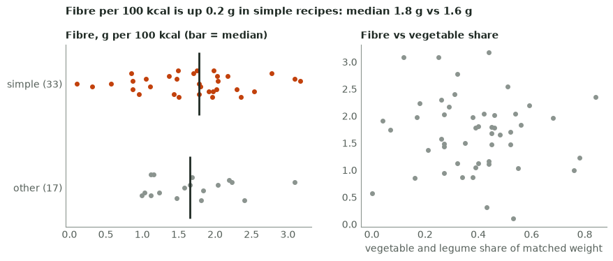

The page passes the automated half of the checklist; now walk items 1, 5, 6, 8 and 10 yourself. Note that the alt text states the correlation it computed instead of claiming one: a sentence in alt text must be as true as the headline. On this synthetic fixture the difference between the groups is small; with real data, check the counts before you headline a fraction of a gram. **Common wrong answer:** a headline without a verb or number (“Fibre overview”), which the linter rejects. **Interviewer follow-up:** “how would this run on the real mart?” → same `build()` reading the dbt mart instead of the CSV, the linter in CI, the PNG and alt text in the README.
